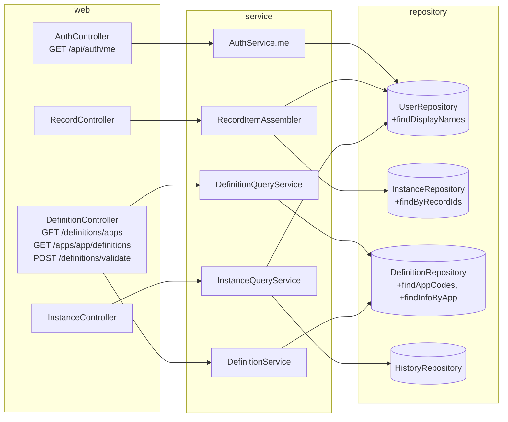
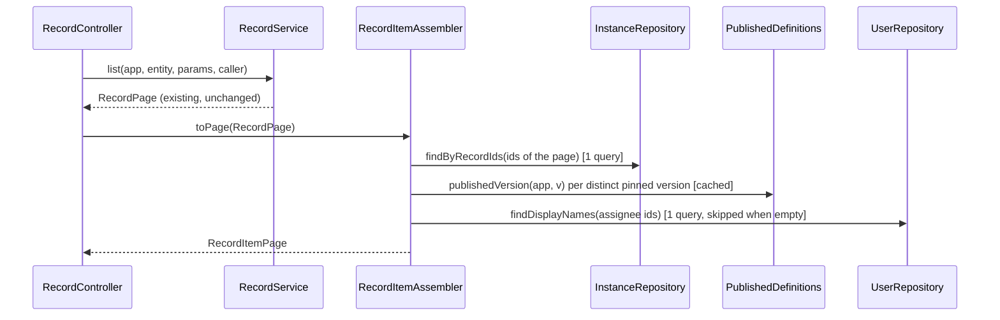
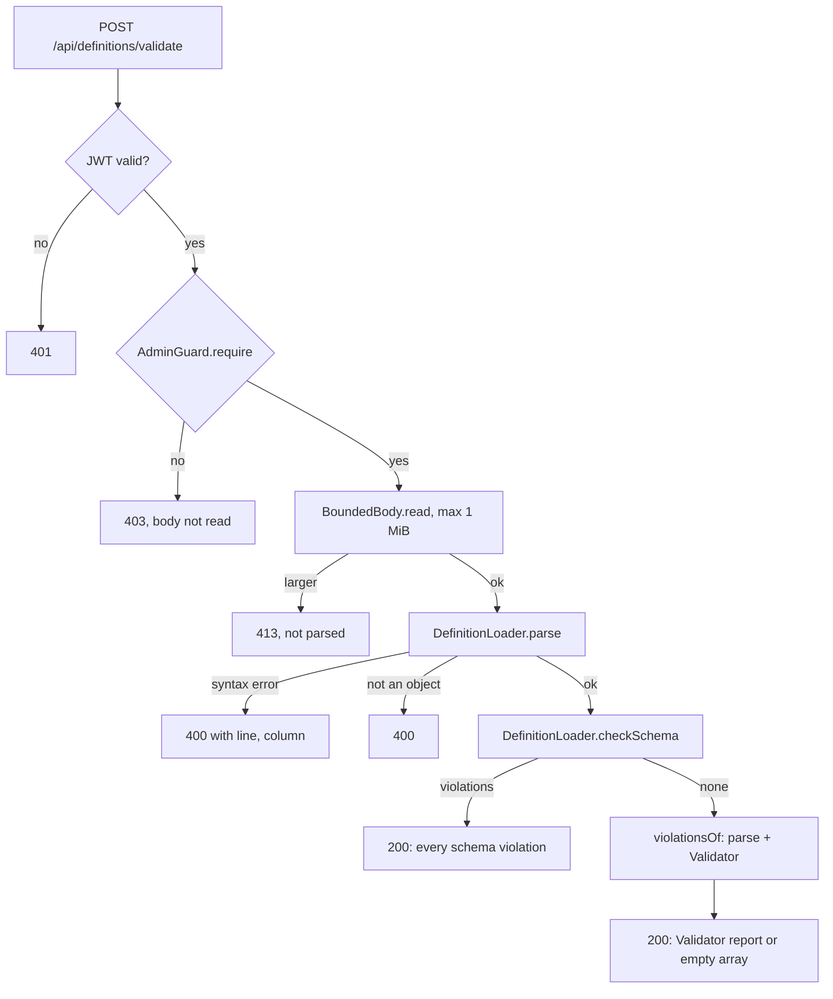

# Design Document

## Overview

This feature adds the backend capabilities that the Skeleton Frontend lists as BD-1 to BD-6 and BD-8. It is additive: new endpoints, new response properties and one optional schema property. No migration, no new configuration property, no change to the Router, the Validator rules or the SLA scheduler.

The design was written against the real code in `skeleton/backend` (Java 21, Spring Boot 3.5, package root `dev.skeletonkey`). Findings from reading it that shape the design:

| Finding | Consequence |
|---|---|
| `DefinitionReadService.appNode(AppInfo)` already writes `app.branding` (only non-null `primaryColor`, `logo`, `theme`; an empty object stays `{}`), and both `readRestricted` and `readPublicSubset` use it. | Requirement 5 needs **no production change**. The work is verification: tests that pin the behaviour (partial, empty, absent, both projections). |
| `Router` rejects `PARALLEL` and `JOIN` steps and `InstanceState` holds a single `step`. | A Workflow_Instance never has several current steps today. Requirement 2.18 holds by construction: summary fields always come from `InstanceState.step()`. |
| `RecordService` has a public constructor used directly by `RecordServiceTest`, `RecordListingTest` and by `ApplicationContextTest` through `RecordPage`/`RecordView`. | `RecordService`, `RecordView` and `RecordPage` stay unchanged. A new assembler in the `record` package enriches their output, so existing tests keep their setup. |
| `HistoryEntry` (domain model record) is built with positional constructors in `Router`, `EventRunner`, `TransitionSelector` and `JdbcHistoryRepository`. | `HistoryEntry` stays unchanged and immutable. The API gets a new view record `HistoryEntryView` with the same property names plus `actorName`. |
| `Field` is a record built with 14 positional arguments in `DefinitionParser` and in 7 test sites. | Add `widget` as a 15th component and keep a secondary 14-argument constructor, so no existing call site changes. |
| `DefinitionService.publish` validates through a private `validate(JsonNode)` that throws `ValidationFailed`. | Extract one shared method that returns the violation list. Publish and the new validate endpoint both call it, which makes requirement 7.3 and 7.10 true by construction. |
| `DefinitionVersionRef` has `id, appCode, version, status, contentHash` and no timestamps. | Add `createdAt` and `publishedAt` (additive). The same record serves the version list. |
| `ApiExceptionHandler` maps `AuthenticationException` to 401, `AccessDeniedException` to 403, `NotFound` to 404, `BadRequest` to 400, `DefinitionSyntaxException` to 400 with `line` and `column`. No handler for 413. | Reuse these. Add one `PayloadTooLarge` exception and one handler method for 413. |
| Controllers use `RecordController.caller()` (package-private static) and `AdminGuard.require(Principal)`. | New endpoints follow the same pattern. No endpoint compares roles itself. |
| `JacksonConfig` serializes every `Instant` as `yyyy-MM-dd'T'HH:mm:ss.SSS'Z'`. | New timestamp properties are plain `Instant` components and already meet the 3-digit UTC format. |
| Existing web tests (`DefinitionReadTest`, `AuthSecurityTest`) build a small `@SpringJUnitWebConfig` context with `InMemory*Repository` classes. `ApplicationContextTest` boots the full app on Testcontainers PostgreSQL. | New tests follow the same two styles. |

### Design decisions

| Decision | Rationale |
|---|---|
| Batch reads at the repository port: `InstanceRepository.findByRecordIds`, `UserRepository.findDisplayNames`. | Requirements 2.14 and 3.6 bound the query count. A port method that takes a collection issues one SQL statement, and tests can count calls on a wrapper. |
| One pure class `WorkflowSummary` builds the summary from `InstanceState`, the pinned `Workflow` and a name lookup. | All of requirements 2.3 to 2.12 live in one function that jqwik can drive without Spring. |
| `RecordItem` (new response record) holds the existing `RecordView` properties plus the summary, flat. | The frontend type `RecordSummary` is flat. Jackson serializes a record's components flat, so existing property names do not change (2.15). |
| `HistoryEntryView` and `actorName` are resolved at read time, never stored. | Requirements 3.7 and 3.9: the history table stays immutable and a renamed user shows the new name. |
| `/api/auth/me` reads the user from `UserRepository.findById`, not from the JWT. | Requirements 1.4 and 1.5: roles and the active flag come from the store. |
| Validation report shared through `DefinitionService.violationsOf(JsonNode)`. | One code path for Publish and Validate_Endpoint. |
| Validate endpoint reads its body itself with a 1 MiB cap, after the admin check. | Requirements 7.7 and 7.13: a non-admin body is never evaluated, an oversized body is never parsed. A normal `@RequestBody String` would buffer the whole body first. |
| `widget` is added to the schema, the `Field` record, `DefinitionParser` and the `fieldNode` projection. | Requirement 6, and the repository rule that schema, Java model, validator and examples change together. |

## Architecture



### Read path of a record list (Requirement 2)



Visibility is decided inside `RecordService.list` and `read` (Requirement 2.16). The assembler only decorates items that service already returned, so an invisible record never reaches it.

### Validate path (Requirement 7)



Nothing in this path calls the repository or `AuditService` (Requirement 7.6).

## Components and Interfaces

### 1. Current user (Requirement 1)

`web/CurrentUserResponse.java`
```java
public record CurrentUserResponse(UUID userId, String displayName, List<String> roles) {}
```
The record has exactly three components, so the password hash, user name and token cannot leak (1.2).

`AuthController` adds:
```java
@GetMapping("/me")
@Operation(summary = "Current user", security = @SecurityRequirement(name = "bearerAuth"))
@ApiResponse(responseCode = "200", content = @Content(schema = @Schema(implementation = CurrentUserResponse.class)))
@ApiResponse(responseCode = "401", content = @Content(schema = @Schema(implementation = ApiError.class)))
public CurrentUserResponse me() { return auth.me(RecordController.caller()); }
```
`SecurityConfig` needs no change: `/api/auth/me` falls under `anyRequest().authenticated()`, so a missing or tampered JWT gets the 401 entry point with the `ApiError` body (1.3).

`AuthService` adds:
```java
public CurrentUserResponse me(Principal caller) {
    UserAccount user = users.findById(caller.userId())
            .filter(UserAccount::active)
            .orElseThrow(() -> new BadCredentialsException("Authentication required"));
    return new CurrentUserResponse(user.id(), user.displayName(), new ArrayList<>(new TreeSet<>(user.roles())));
}
```
`BadCredentialsException` is an `AuthenticationException`, so `ApiExceptionHandler.unauthenticated` returns 401 `UNAUTHENTICATED` (1.4). Roles come only from `user.roles()`, never from the JWT (1.5). A null `userId` (anonymous principal) cannot reach this method because the route is authenticated.

### 2. Workflow summary on records (Requirement 2)

`record/WorkflowSummary.java` (pure, no Spring):
```java
public record WorkflowSummary(UUID instanceId, String step, String stepLabel, String status, String statusColor,
                              UUID assignee, String assigneeName, Instant dueAt, boolean ended) {
    public static final WorkflowSummary NONE =
            new WorkflowSummary(null, null, null, null, null, null, null, null, false);

    /** instance may be null (record without instance). names maps user id to display name. */
    public static WorkflowSummary of(InstanceState instance, Workflow pinned, Map<UUID, String> names) { ... }
}
```
Rules implemented in `of`:
- `instance == null` returns `NONE` (2.11).
- `instanceId = instance.id()`, `step = instance.step()`, `status = instance.status()`, `ended = instance.ended()` (2.3).
- `stepLabel`: `pinned.step(code)` label if present and non-blank, else the step code (2.4).
- `statusColor`: the `color` of the status in `pinned.statuses()` whose label equals `instance.status()`, else null (2.5).
- When `ended`: `assignee`, `assigneeName`, `dueAt` are null (2.10). Otherwise `assignee = instance.assigneeId()`, `dueAt = instance.dueAt()`, `assigneeName = names.get(assignee)` which is null for an unknown user, with `assignee` kept (2.6, 2.7, 2.8, 2.9).
- `pinned == null` is tolerated: label falls back to the step code and color to null.

`record/RecordItem.java`:
```java
public record RecordItem(UUID id, String referenceNo, String appCode, int defVersion, String entityCode,
                         Map<String, Object> data, UUID createdBy, Instant createdAt, Instant updatedAt,
                         UUID instanceId, String step, String stepLabel, String status, String statusColor,
                         UUID assignee, String assigneeName, Instant dueAt, boolean ended) {
    public static RecordItem of(RecordView v, WorkflowSummary s) { ... }
}
public record RecordItemPage(List<RecordItem> items, int page, int size, long total, String sort) {}
```
The first nine components are the existing `RecordView` components in the same order and with the same names (2.15).

`record/RecordItemAssembler.java` (`@Service`):
```java
public RecordItem item(RecordView view);            // read, create, replace, patch (2.2, 2.13)
public RecordItemPage page(RecordPage page);        // list (2.1, 2.14)
```
`page` algorithm, with a fixed number of repository calls:
1. `ids = items.map(id)`. `Map<UUID, InstanceState> byRecord = instances.findByRecordIds(ids)` (1 query, none when `ids` is empty).
2. Group the instances by `(appCode, defVersion)`. For each distinct pair call `definitions.publishedVersion(app, version)`. The result is read from `DefinitionCache` after the first load, and the number of distinct pairs depends on how many definition versions are pinned, not on N (2.12).
3. `assigneeIds` = distinct non-null `assigneeId` of instances that are not ended. `Map<UUID, String> names = users.findDisplayNames(assigneeIds)` (1 query, none when empty).
4. Build each item with `WorkflowSummary.of`.

`item(view)` runs the same steps with a single-element list, so list and read share one code path.

Worst case query count for a page: `1 (instances) + 1 (users) + V (distinct pinned versions, cached)`. For N = 1 and N = 100 over data pinned to one version, the count is identical (2.14).

`RecordController` changes: return types become `RecordItem` and `RecordItemPage`; each method calls the service as before and passes the result to the assembler. The controller contains no logic. `FormController` (public submit) is not touched, so the public role never receives a summary (2.17).

Repository additions:
```java
// InstanceRepository
Map<UUID, InstanceState> findByRecordIds(Collection<UUID> recordIds);   // one SELECT ... WHERE record_id IN (:ids)

// UserRepository
Map<UUID, String> findDisplayNames(Collection<UUID> userIds);           // one SELECT id, display_name ... WHERE id IN (:ids)
```
Both return an empty map without touching the database when the argument is empty. `JdbcInstanceRepository` reuses its `MAPPER`; `JdbcUserRepository` reads only `id` and `display_name` (no role query, so one statement). `InMemoryInstanceRepository` and `InMemoryUserRepository` (test sources) get the same two methods.

### 3. Names on the Instance_View and history (Requirement 3)

`InstanceView` gets one more component, `String assigneeName`, placed after `assignee`. `InstanceQueryService.build` receives it from `users.findDisplayNames(Set.of(assigneeId))`, at most one lookup (3.1 to 3.3).

`app/HistoryEntryView.java`:
```java
public record HistoryEntryView(String kind, String actionCode, String fromStep, String toStep, String fromStatus,
                               String toStatus, UUID actorId, String actorName, String remarks,
                               String attachmentRef, JsonNode detail, Instant eventTime, long timeInStepMs) {
    public static HistoryEntryView of(HistoryEntry e, String actorName) { ... }
}
```
`InstanceQueryService.history` keeps its stable sort, then:
```java
Set<UUID> actors = entries.stream().map(HistoryEntry::actorId)
        .filter(Objects::nonNull).filter(id -> !id.equals(DefinitionService.SYSTEM_ACTOR.userId()))
        .collect(toCollection(LinkedHashSet::new));
Map<UUID, String> names = users.findDisplayNames(actors);   // 0 or 1 query
return entries.stream().map(e -> HistoryEntryView.of(e, e.actorId() == null ? null : names.get(e.actorId()))).toList();
```
The reserved system actor (all-zero UUID) is excluded before the lookup, so `actorName` is null for it (3.5). Order, count and values of existing properties are copied unchanged (3.7). Nothing is written (3.9). `InstanceController.history` returns `List<HistoryEntryView>`.

`InstanceQueryService` gets a `UserRepository` constructor parameter. It is a Spring bean, so the application context supplies it. Test contexts that declare `InstanceQueryService` already declare a `UserRepository` bean.

### 4. Definition version list and app code list (Requirement 4)

`persistence/DefinitionVersionInfo.java`:
```java
public record DefinitionVersionInfo(UUID id, String appCode, int version, String status, String contentHash,
                                    Instant createdAt, Instant publishedAt) {}
```
`DefinitionRepository` additions:
```java
List<String> findAppCodes();                            // SELECT DISTINCT app_code ... ORDER BY app_code COLLATE "C"
List<DefinitionVersionInfo> findInfoByApp(String appCode);   // no document column, ORDER BY version DESC
```
The two methods never load the JSONB `document` column. `InMemoryDefinitionRepository` implements them with a sorted stream (`String.compareTo`, which equals code point order for the ASCII app code pattern).

`DefinitionVersionRef` becomes
```java
public record DefinitionVersionRef(UUID id, String appCode, int version, String status, String contentHash,
                                   Instant createdAt, Instant publishedAt)
```
with `of(DefinitionVersionRow)` and `of(DefinitionVersionInfo)`. Existing endpoints now also show the two timestamps (additive). `publishedAt` is null while DRAFT.

`definition/DefinitionQueryService.java` (`@Service`, read-only):
```java
public List<String> appCodes();
public List<DefinitionVersionRef> versions(String appCode);   // 404 NotFound("App not found") when no rows or code fails ^[A-Z][A-Z0-9_]{0,63}$
```
Both messages for "bad pattern" and "no such app" are identical (4.5).

`DefinitionController` adds, each starting with `admin.require(RecordController.caller())` so a non-admin gets 403 before any lookup and learns nothing about the app (4.6):
```java
@GetMapping("/definitions/apps")               List<String> apps()
@GetMapping("/apps/{app}/definitions")         List<DefinitionVersionRef> versions(@PathVariable String app)
```
Route clash check: `GET /api/definitions/{id}` takes a UUID and `GET /api/definitions/apps` is a literal. Spring MVC ranks the literal pattern first, so `apps` is never bound to `{id}`. `/api/apps/{app}/definitions` does not collide with `/api/apps/{app}/definition` (read) or `/api/apps/{app}/definitions/{base}/edit`.

401 comes from the security chain. OpenAPI: `@Operation` and `@ApiResponse` for 200, 401, 403 (and 404 for versions) on both methods (4.9).

### 5. Branding in both projections (Requirement 5)

No production change. `DefinitionReadService.appNode` already:
- omits `branding` when `AppInfo.branding()` is null (5.3),
- writes only non-null `primaryColor`, `logo`, `theme` (5.1, 5.4),
- writes `{}` for an empty branding object (5.8),
- is used by both `restrict` and `readPublicSubset` for the same `PublishedApp` (5.2, 5.6),
- leaves `code`, `name`, `description` untouched (5.5).

`DefinitionParser` creates a `Branding` only when `app.branding` is an object, which gives the "absent versus empty" distinction. The public allow-list (5.7) is the explicit node building in `readPublicSubset`: nothing is copied by serialization. The design adds tests only (see Testing Strategy). If a test finds a gap (for example a `null` value or an extra key) the fix is local to `appNode`.

### 6. Widget property (Requirement 6)

Schema change in `schema/app-definition.schema.json`, inside `$defs.field.properties`:
```json
"widget": {
  "type": "string",
  "minLength": 1,
  "maxLength": 64,
  "pattern": "^[a-zA-Z][a-zA-Z0-9_-]{0,63}$",
  "description": "Optional key of a frontend widget registered by the app. The backend has no widget registry."
}
```
The field keeps `additionalProperties: false`, so every other unknown key is still rejected. Because the `networknt` validator reports the failing keyword at the property's instance location, a bad value is reported at `/entities/{i}/fields/{j}/widget` (6.3). The document is rejected by `DefinitionLoader.load` through `DefinitionSchemaException` (422, nothing stored).

Java model:
```java
public record Field(String code, String label, Type type, boolean required, String help, JsonNode defaultValue,
                    List<Option> options, String ref, Double min, Double max, Integer maxLength,
                    String pattern, String accept, Integer maxFiles, String widget) {
    /** Keeps the 14-argument call sites (tests, parser history) valid; widget is absent. */
    public Field(String code, String label, Type type, boolean required, String help, JsonNode defaultValue,
                 List<Option> options, String ref, Double min, Double max, Integer maxLength,
                 String pattern, String accept, Integer maxFiles) {
        this(code, label, type, required, help, defaultValue, options, ref, min, max, maxLength, pattern, accept,
             maxFiles, null);
    }
    ...
}
```
`DefinitionParser.field` passes `optStr(n, "widget")`. `DefinitionReadService.fieldNode` adds `putIfNotNull(n, "widget", f.widget())` and is made package-private (`static ObjectNode fieldNode(Field)`) so a jqwik test in the same package can call it. Both projections build field nodes through `fieldNode`, so 6.8 is met for both.

The Validator has no rule that reads `widget`, so a key that matches no frontend widget is accepted (6.7). The stored `document` is the submitted `JsonNode`, so `widget` is returned character for character (6.6).

Round trip (6.5): the Java model has no writer; documents are stored as the original `JsonNode`. The property therefore checks the path the system really has: text → `DefinitionLoader.load` → stored document → serialized text → `DefinitionLoader.load` again, JSON-equal to the original, with no `widget` key added to a field that had none, and `DefinitionParser.parse(document)` returns the declared widget (or null) for every field. A model-to-JSON writer is deliberately not added (lean principle: nothing would use it).

Other files in the same change (repository rule): `.kiro/steering/app-definition.md` needs no change, because it references `schema/app-definition.schema.json` instead of embedding a copy, so only the schema file receives the `widget` block. `examples/grievance.app.json` is unchanged (6.9). `skeleton/frontend` does not exist in the repository yet, so criterion 6.10 has nothing to update today; the frontend design already lists `widget?: string` on `FieldDef`.

Generator change (6.11): `DefinitionArbitraries.Builder` adds a `widget` to about half of the generated fields, drawn from a pattern-valid pool that includes mixed case, `_` and `-`.

### 7. Validate without storing (Requirement 7)

`DefinitionService` refactor:
```java
/** Single source of the publish-time report; Publish and Validate_Endpoint both call it. */
List<ApiViolation> violationsOf(JsonNode document) {
    AppDefinition def;
    try {
        def = parser.parse(document);
    } catch (DefinitionParseException e) {
        return List.of(new ApiViolation("", "PARSE", e.getMessage()));
    }
    return validator.validate(def).violations().stream()
            .map(v -> new ApiViolation(v.path(), v.rule(), v.message())).toList();
}

/** Validate_Endpoint: no write, no audit, no repository call. */
public List<ApiViolation> validateText(String json) {
    JsonNode tree = loader.parse(json);                       // DefinitionSyntaxException -> 400 with line, column
    if (!tree.isObject()) {
        throw new BadRequest("Document must be a JSON object", List.of());   // 400
    }
    List<SchemaViolation> schema = loader.checkSchema(tree);  // all violations, sorted by path then message
    if (!schema.isEmpty()) {
        return schema.stream().map(v -> new ApiViolation(v.path(), v.rule(), v.message())).toList();
    }
    return violationsOf(tree);
}
```
`publish` becomes: `List<ApiViolation> found = violationsOf(row.document()); if (!found.isEmpty()) throw new ValidationFailed(message(found), found);` where `message` returns the existing texts: `"Definition cannot be parsed"` for a single `PARSE` violation and `"Definition has N violation(s)"` otherwise. Existing publish behaviour and messages are unchanged. `ValidationReport` already sorts by `(path, rule, message)`, so order is identical (7.3, 7.9).

`web/BoundedBody.java`:
```java
final class BoundedBody {
    static final int MAX_BYTES = 1_048_576;
    static String read(HttpServletRequest request) throws IOException { ... }   // UTF-8
}
```
It rejects early when `Content-Length` exceeds the limit, otherwise reads at most `MAX_BYTES + 1` bytes and throws `PayloadTooLarge` if the extra byte exists. It never reads past the limit (7.13). The limit is a constant, not a property (Requirement 8.3).

`web/PayloadTooLarge.java` (`RuntimeException`) and one new method in `ApiExceptionHandler`:
```java
@ExceptionHandler(PayloadTooLarge.class)
ResponseEntity<ApiError> tooLarge(PayloadTooLarge e) { return build(413, "PAYLOAD_TOO_LARGE", e.getMessage(), List.of()); }
```

`DefinitionController` adds:
```java
@PostMapping("/definitions/validate")
public List<ApiViolation> validate(HttpServletRequest request) throws IOException {
    admin.require(RecordController.caller());          // 403 before the body is touched
    return service.validateText(BoundedBody.read(request));
}
```
Because `POST /api/definitions` takes `@RequestBody String` and `validate` is a distinct literal path, the two do not clash. `ApiViolation.field` carries the JSON Pointer for schema violations and the validator path for rule violations, as `publish` already returns it.

### 8. Compatibility and tests (Requirement 8)

- No file under `db/migration` is added. `application.properties` and `SkeletonProperties` are not edited.
- `AdminGuard` is the only role check on the new admin endpoints.
- 5xx bodies come from `ApiExceptionHandler.unexpected`, which already returns `Internal server error` plus the request id (8.5).
- Existing tests that compare whole bodies get the new keys added to their expected shape only: `InstanceEndpointsTest` (`assigneeName`, `actorName`) and `FormSubmitTest`/`ApplicationContextTest` only if they assert full record or version bodies.

## Data Models

### Responses added or extended

`GET /api/auth/me`
```json
{ "userId": "6f1c…", "displayName": "Asha Rai", "roles": ["CLERK", "SUPERVISOR"] }
```

Record item (list element and read/create/replace/patch body). Existing properties first, then the summary:
```json
{
  "id": "…", "referenceNo": "GRV-2026-000123", "appCode": "GRIEVANCE", "defVersion": 1, "entityCode": "GRIEVANCE",
  "data": { "subject": "Pothole" }, "createdBy": "…", "createdAt": "2026-03-01T09:00:00.000Z", "updatedAt": "2026-03-01T09:00:00.000Z",
  "instanceId": "…", "step": "TRIAGE", "stepLabel": "Triage", "status": "In progress", "statusColor": "#faad14",
  "assignee": "…", "assigneeName": "Asha Rai", "dueAt": "2026-03-02T09:00:00.000Z", "ended": false
}
```
Record without instance: `instanceId`, `step`, `stepLabel`, `status`, `statusColor`, `assignee`, `assigneeName`, `dueAt` are `null`, `ended` is `false`. Ended instance: `ended` true, `status` = END outcome, `assignee`, `assigneeName`, `dueAt` null.

Instance_View: existing properties plus `assigneeName` (string or null).

History entry: existing properties plus `actorName` (string or null).

Version list element (`GET /api/apps/{app}/definitions`):
```json
{ "id": "…", "appCode": "GRIEVANCE", "version": 2, "status": "DRAFT", "contentHash": "ab12…",
  "createdAt": "2026-03-01T09:30:15.123Z", "publishedAt": null }
```
App list: `["ASSETS", "GRIEVANCE"]`.

Validate response: `[ { "field": "/entities/0/fields/1/widget", "rule": "SCHEMA", "message": "…" } ]`, or `[]`.

Restricted_Definition and Public_Subset: `app.branding` as already produced; each field object may carry `"widget": "starRating"`.

### Types added

| Type | Package | Kind |
|---|---|---|
| `CurrentUserResponse` | `web` | record |
| `WorkflowSummary`, `RecordItem`, `RecordItemPage`, `RecordItemAssembler` | `record` | records and service |
| `HistoryEntryView` | `app` | record |
| `DefinitionVersionInfo` | `persistence` | record |
| `DefinitionQueryService` | `definition` | service |
| `BoundedBody`, `PayloadTooLarge` | `web` | helper and exception |

### Types changed

`InstanceView` (+`assigneeName`), `Field` (+`widget`, secondary constructor), `DefinitionVersionRef` (+`createdAt`, `publishedAt`), `InstanceRepository` (+`findByRecordIds`), `UserRepository` (+`findDisplayNames`), `DefinitionRepository` (+`findAppCodes`, `findInfoByApp`), their JDBC and in-memory implementations, `DefinitionService`, `DefinitionController`, `AuthController`, `AuthService`, `RecordController`, `InstanceController`, `InstanceQueryService`, `ApiExceptionHandler`, `DefinitionParser`, `DefinitionReadService` (visibility of `fieldNode` and `widget`) and the schema (the steering file needs no change because it references the schema file).


## Correctness Properties

_A property is a characteristic or behavior that should hold true across all valid executions of a system, a formal statement about what the system should do. Properties are the bridge between human-readable specifications and machine-verifiable correctness guarantees._

Reflection on redundancy: the per-field summary criteria 2.3 to 2.8 and 2.10 all describe one function (`WorkflowSummary.of`) and collapse into Property 2. The history criteria 3.4 to 3.8 describe one transformation and collapse into Property 5. Widget criteria 6.4 to 6.6 are one round-trip property (Property 9); 6.7 and 6.8 are grouped in Property 10. Validate criteria 7.1 to 7.4 and 7.10 are one consistency property (Property 11); 7.6 and 7.9 are Property 12. Criteria that are single examples, security-chain cases, OpenAPI and file-level checks stay example or smoke tests and have no property.

### Property 1: Current user comes from the store

*For any* stored user (any active flag, any role set) and any Principal whose JWT role set differs from the stored role set, `AuthService.me` returns, when the user exists and is active, a response whose `userId` and `displayName` equal the stored values and whose `roles` equal the stored roles sorted, with no role taken from the Principal; and throws an `AuthenticationException` when the user is absent or inactive.

**Validates: Requirements 1.1, 1.4, 1.5**

### Property 2: Workflow summary mapping

*For any* Workflow_Instance state (running or ended, assigned or not, any step code, any status label), any pinned workflow (steps with or without labels, statuses with or without colors, step or status possibly missing from the workflow) and any name map (assignee present or absent), `WorkflowSummary.of` returns: `instanceId`, `step`, `status` and `ended` equal to the instance values; `stepLabel` equal to the step label when the pinned step has a non-blank one and to the step code otherwise; `statusColor` equal to the color of the pinned status with the same label and null otherwise; and, when the instance is not ended, `assignee` equal to the instance assignee, `assigneeName` equal to the mapped name or null, `dueAt` equal to the instance due time; when the instance is ended, `assignee`, `assigneeName` and `dueAt` are all null. For a null instance the result is `NONE`.

**Validates: Requirements 2.3, 2.4, 2.5, 2.6, 2.7, 2.8, 2.10, 2.11**

### Property 3: Summary never alters the record

*For any* `RecordView` and any `WorkflowSummary`, the `RecordItem` built from them carries the nine `RecordView` values unchanged, and for a page, the `RecordItemPage` has the same `page`, `size`, `total`, `sort` and the same item order as the source `RecordPage`.

**Validates: Requirements 2.15**

### Property 4: Page enrichment cost does not depend on page size

*For any* page of N records (N from 1 to 100) whose instances are pinned to one definition version, `RecordItemAssembler.page` calls `InstanceRepository.findByRecordIds` exactly once and `UserRepository.findDisplayNames` at most once, and the total number of repository calls is the same for every N.

**Validates: Requirements 2.1, 2.14**

### Property 5: History names are resolved, never stored, and cost at most one lookup

*For any* list of history entries (actor ids drawn from known users, unknown users, null and the reserved system actor, 0 to 1,000 entries) and any user set, `InstanceQueryService.history` returns the same number of entries in the same order with every existing property equal to the source entry; `actorName` equals the stored display name when the actor is a known non-system user and is null otherwise; `UserRepository` is queried at most once; the history repository receives no write; and reading twice with no change returns equal lists.

**Validates: Requirements 3.4, 3.5, 3.6, 3.7, 3.8**

### Property 6: App list and version list are complete and ordered

*For any* set of stored Definition_Versions over several app codes (including the empty set), `DefinitionQueryService.appCodes` returns each code that has at least one version exactly once in ascending order; and for any app code in that set, `versions` returns one entry per stored version in strictly descending version order, each with `id`, `version`, `status`, `contentHash`, `createdAt`, and `publishedAt` null if and only if the status is DRAFT; and for any string that is not the code of a stored app, `versions` throws `NotFound`. Neither method changes the stored rows.

**Validates: Requirements 4.1, 4.2, 4.3, 4.4, 4.5, 4.8**

### Property 7: Branding is projected as declared in both projections

*For any* published definition whose `app.branding` is absent, empty, or holds any subset of `primaryColor`, `logo` and `theme`, both `readRestricted` and `readPublicSubset` return an `app` object whose `branding` has exactly the declared properties with the declared values (no `branding` key when absent, `{}` when empty), whose other `app` properties equal those of the same definition without branding, and the public subset contains no key outside its allow-list.

**Validates: Requirements 5.1, 5.2, 5.3, 5.4, 5.5, 5.7, 5.8**

### Property 8: Widget schema acceptance

*For any* string, a field in an otherwise valid document that declares it as `widget` is accepted by `DefinitionLoader.load` if and only if it matches `^[a-zA-Z][a-zA-Z0-9_-]{0,63}$`; and *for any* non-string JSON value, the document is rejected. In each rejected case at least one violation has the JSON Pointer of that field's `widget` property and nothing is stored.

**Validates: Requirements 6.2, 6.3**

### Property 9: Widget round trip

*For any* schema-valid definition document in which each field has a widget key with probability one half, loading it, serializing the stored document and loading the result again gives a document JSON-equal to the original; no field without `widget` gains a `widget` key (not even `null`); every `widget` value is returned character for character with case preserved; and `DefinitionParser.parse` yields a `Field.widget()` equal to the declared string, or null when it is absent.

**Validates: Requirements 6.4, 6.5, 6.6**

### Property 10: Widgets pass the validator and reach the projections

*For any* valid generated definition with widget keys that match no registered widget, `Validator.validate` reports no violation, and for every field `fieldNode(field)` has a `widget` property equal to the declared value if and only if the field declares one.

**Validates: Requirements 6.7, 6.8**

### Property 11: Validate equals Publish

*For any* schema-valid definition document (valid generated definitions and definitions with injected defects), the list returned by `DefinitionService.validateText` equals the violation list carried by the `ValidationFailed` that `publish` throws for the same document stored as a DRAFT (same entries, same order), and is empty exactly when `publish` succeeds. *For any* document with schema violations, the list returned by `validateText` equals `DefinitionLoader.checkSchema` mapped to `{field, rule, message}`, with every violation present.

**Validates: Requirements 7.1, 7.2, 7.3, 7.4, 7.10**

### Property 12: Validate is idempotent and has no side effect

*For any* document text that parses to a JSON object, calling `validateText` twice returns equal lists, and the stored Definition_Versions and the audit entries are identical before and after both calls, including when the text carries the app code and content of an existing version.

**Validates: Requirements 7.6, 7.9, 7.11**

### Property 13: Unparseable text is a 400 with a position

*For any* valid definition text cut at a random offset that makes it unparseable, and for the empty and blank text, `validateText` throws `DefinitionSyntaxException` with `line` and `column` of at least 1; and *for any* JSON text whose top level is not an object (array, string, number, boolean, null), it throws `BadRequest`.

**Validates: Requirements 7.5**

### Property 14: Body size bound

*For any* byte array of length L, `BoundedBody.read` returns the UTF-8 text of the bytes when L is at most 1,048,576, and throws `PayloadTooLarge` when L is greater, without reading more than 1,048,577 bytes from the stream.

**Validates: Requirements 7.13**

## Error Handling

All errors go through `ApiExceptionHandler` and use the common `ApiError` body. Nothing new is added except the 413 handler.

| Situation | Status and code | Source |
|---|---|---|
| `/api/auth/me` with missing, expired or tampered JWT | 401 `UNAUTHENTICATED` | security entry point |
| `/api/auth/me`, user absent or inactive | 401 `UNAUTHENTICATED` | `BadCredentialsException` in `AuthService.me`, handled by `unauthenticated` |
| New admin endpoint, no JWT or bad JWT | 401 `UNAUTHENTICATED` | security entry point |
| New admin endpoint, no Platform_Admin role | 403 `FORBIDDEN`, body identical for existing and unknown apps | `AdminGuard.require` throws `AccessDeniedException` before any lookup |
| Version list, app unknown or code not matching the pattern | 404 `NOT_FOUND`, message "App not found" | `NotFound` from `DefinitionQueryService` |
| Validate, body empty or not well-formed JSON | 400 `MALFORMED_JSON` with `line` and `column` | `DefinitionSyntaxException` (existing handler) |
| Validate, top-level value is not an object | 400 `BAD_REQUEST` | `BadRequest` |
| Validate, body over 1,048,576 bytes | 413 `PAYLOAD_TOO_LARGE` | `PayloadTooLarge` (new handler) |
| Validate, schema or rule violations | 200 with the report (not an error) | `DefinitionService.validateText` |
| Record or instance reads, unexpected failure | 500 `INTERNAL_ERROR`, "Internal server error", `requestId`, no stack, class name, SQL or path | `ApiExceptionHandler.unexpected` |

Degraded data is never an error: an assignee without a user, an actor without a user, a step missing from the pinned workflow or a status without color all produce nulls (or the step code for the label) and the request succeeds. If `PublishedDefinitions.publishedVersion` finds no pinned version for an instance while a record list is assembled, the summary is built with `pinned = null` (label falls back to the step code, color to null) instead of failing the whole page. `InstanceQueryService.view` keeps its existing 500 `PINNED_DEFINITION_MISSING` behaviour because it needs the workflow to compute actions.

## Testing Strategy

Property-based testing applies here: the summary mapping, name resolution, version ordering, validation consistency, round trip and size bound are pure or in-memory logic with large input spaces. Wiring, security-chain statuses, OpenAPI and SQL are covered by example-based and Testcontainers tests.

### Library and configuration

- **jqwik** (already a test dependency; `junit-platform.properties` sets `jqwik.tries.default=100`). Each property is one `@Property` method. Properties that build Spring contexts or Testcontainers are not used; the properties run on in-memory repositories (`InMemoryUserRepository`, `InMemoryInstanceRepository`, `InMemoryDefinitionRepository`, `InMemoryHistoryRepository`, `InMemoryAuditRepository`) and on the existing generators `DefinitionArbitraries`, `Mutations`, `PrincipalArbitraries`.
- Minimum 100 tries per property (`@Property(tries = 100)` where a property needs more, for example Property 9 and 11 use 200).
- Each property carries a comment tag: `// Feature: frontend-backend-support, Property N: <title>`.
- No property-based testing library is implemented by hand.

### Property tests

| Property | Test class (package under `src/test/java/dev/skeletonkey`) | Generators |
|---|---|---|
| 1 | `app/CurrentUserPropertyTest` | users with random roles, active flag, differing Principal roles |
| 2, 3 | `record/WorkflowSummaryPropertyTest` | `InstanceState`, `Workflow` built from `DefinitionArbitraries`, name maps |
| 4 | `record/RecordItemAssemblerQueryCountPropertyTest` | N records, counting wrappers around the in-memory repositories |
| 5 | `app/HistoryNamesPropertyTest` | entries with mixed actor ids, 0 to 1,000 entries, counting `UserRepository` |
| 6 | `definition/DefinitionQueryPropertyTest` | sets of `(appCode, version, status)` rows, random strings for the 404 case |
| 7 | `definition/BrandingProjectionPropertyTest` | `validDefinitionJson` with branding subsets (absent, empty, partial, full) |
| 8 | `domain/load/WidgetSchemaPropertyTest` | strings matching and not matching the pattern, non-string JSON values |
| 9 | `domain/load/WidgetRoundTripPropertyTest` | `validDefinitionJson` (generator now sets `widget` on about half of the fields) |
| 10 | `definition/WidgetProjectionPropertyTest` (same package as `DefinitionReadService`, to reach `fieldNode`) | `validDefinition` |
| 11, 12, 13 | `definition/ValidateEndpointPropertyTest` | `validDefinitionJson`, `Mutations` (defect injection), schema-breaking edits, truncated texts |
| 14 | `web/BoundedBodyPropertyTest` | byte arrays around the limit (limit - 1, limit, limit + 1, random) |

Existing generator changes: `DefinitionArbitraries.Builder` adds `widget` to fields and optional `branding` subsets. Because generated definitions pass through every existing property test, those tests also confirm that widgets do not disturb the Validator or the Router.

### Example-based and integration tests

- **Web tests with the in-memory context** (same style as `DefinitionReadTest` and `AuthSecurityTest`: `@SpringJUnitWebConfig`, `springSecurity()`, `JwtService.issue`):
  - `AuthMeTest`: 200 shape (exactly three keys, no `passwordHash`/`username`/`token`), 401 for no, expired and tampered tokens, 401 for inactive and deleted user.
  - `DefinitionListEndpointsTest`: 200 for admin, 403 for non-admin with equal bodies for existing and unknown apps, 401, 404 for unknown and malformed app code, timestamp pattern `\d{4}-\d{2}-\d{2}T\d{2}:\d{2}:\d{2}\.\d{3}Z`.
  - `ValidateEndpointTest`: 200 with `[]` and with violations, 400 for empty, malformed (checks `line`, `column`) and array body, 403 for non-admin with an oversized body (body not read), 401, 413 for a 1 MiB + 1 body, rejected before parsing, nothing stored.
  - `DefinitionReadTest` additions: branding in both projections (full, partial, empty, absent), `widget` in field objects of both projections, allow-list check on the public subset keys.
  - `InstanceEndpointsTest` additions: `assigneeName` known, absent and unknown assignee; `actorName` for a known user, null actor, system actor and unknown user; a renamed user shows the new name on old entries.
  - `FormSubmitTest` addition: the public submit response has no summary keys (2.17).
- **Testcontainers PostgreSQL integration test** (`web/FrontendBackendSupportIT`, following `ApplicationContextTest`: `@Testcontainers`, `@SpringBootTest`, `postgres:16-alpine`, `@DynamicPropertySource`, seeded users from a temp seed file):
  - Me endpoint: success and 401.
  - App list and version list on real SQL, including DRAFT and PUBLISHED rows and a non-admin 403.
  - Validate endpoint: success, 400, 403, 401.
  - Record list and read for the five summary cases of Requirement 2 (instance running, ended, assignee absent, assignee unknown, record without instance), on both the list and the read response.
  - Query count on real SQL: a `DataSource` wrapper (counting `JdbcTemplate` statements through a `StatementInspector`-style `BeanPostProcessor` on `JdbcClient`) shows the same number of statements for a list of 1 and of 50 items, and a history of 1 and of 200 entries issues one user statement. Property 4 and 5 prove the same bound at the port level; this test proves that the JDBC adapters issue one statement per port call.
  - `/v3/api-docs` lists `/api/auth/me`, `/api/definitions/apps`, `/api/apps/{app}/definitions` and `/api/definitions/validate` with the documented responses (smoke).
  - Flyway: the migration folder still holds only `V1` and `V2` (smoke for Requirement 8.2).
- **Regression**: `mvnw.cmd test` in `skeleton\backend` must pass all 237 existing tests. Only expected-shape updates for the new keys are allowed in existing tests (Requirement 8.1).

### Commands (Windows CMD)

```
cd skeleton\backend
mvnw.cmd test
mvnw.cmd test -Dtest=ValidateEndpointPropertyTest
mvnw.cmd test -Dtest=FrontendBackendSupportIT
```

Docker must be running for the Testcontainers tests.
