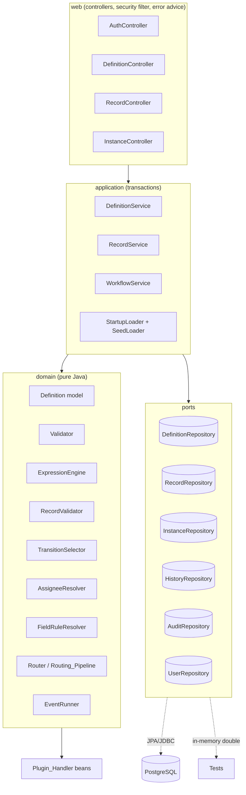
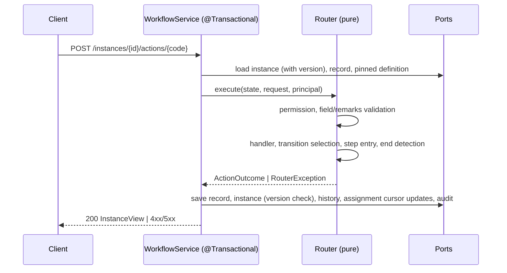

# Design Document

## Overview

The Skeleton Backend is a Spring Boot 3 / Java 21 application (package `dev.skeletonkey`) that runs an app described by one versioned JSON App Definition. It has five jobs:

1. Load and store whole-document App_Definitions (DRAFT / PUBLISHED) with a content hash.
2. Validate a definition at publish time (schema, cross-references, workflow graph, expressions, handlers).
3. Expose a metadata-driven Records API over PostgreSQL JSONB.
4. Run workflow instances through a single Routing_Pipeline, pinned to the definition version they started on.
5. Provide auth (JWT), seed users, an instance view, a definition read endpoint (with a public subset) and an audit trail.

Key design decisions:

| Decision | Rationale |
|---|---|
| Pure-core, impure-shell. Validator, Expression evaluator, TransitionSelector, AssigneeResolver, FieldRuleResolver, RecordValidator and the Router pipeline logic are pure Java over plain objects. Persistence sits behind ports (interfaces). | Makes jqwik properties cheap (Req 18, 19.9 require an in-memory persistence double) and keeps rollback semantics simple. |
| Definition is parsed into an immutable Java model (records) once per version and cached by `(appCode, version)`. | Router and Validator never touch raw JSON; pinned version lookup is a cache hit. |
| JSONLogic evaluation is delegated to an existing Java library (json-logic-java by jamsesso, `io.github.jamsesso:json-logic-java`) wrapped behind the `ExpressionEngine` interface. A small in-house walker is kept only for analysis. | The Validator must enumerate operators, `var` paths and parse errors with JSON Pointers (Req 4), which libraries do not expose, so analysis stays in-house. Evaluation is standard behavior and is not re-implemented. A fixed operator allow-list gates both paths: `==, !=, ===, !==, !, !!, and, or, if, >, >=, <, <=, +, -, *, /, %, min, max, in, var, cat, missing, missing_some, merge`. |
| Entering a step resolves status by fixed precedence: selected Transition `status`, then Action `status`, then target Step `status`, else the current status is kept (END uses `outcome`). | Req 10.14. The selected Transition is carried into step entry so its status can be applied. |
| Side effects that belong to an outcome (assignment cursor moves) are part of `ActionOutcome` and persisted with it. | A rejected or failed action must never advance a round-robin cursor (Req 9.14). |
| Records stored as `jsonb data` in one `record` table; no per-field columns. | Req 7.17: no migration per field change. |
| Optimistic locking with a `version` column on `workflow_instance`. | Req 9.13. |
| Statuses are plain strings validated against the pinned workflow's `statuses`. | Req 20.8: no Java enum for status. |
| Instance state changes are computed as a `ActionOutcome` value (new state + history entries + field changes) by pure code, then persisted in one `@Transactional` method. | Req 9.12/9.14: all-or-nothing. A failure before persistence means nothing is written. |
| Flyway for migrations; `application.properties` for config; `@ConfigurationProperties(prefix = "skeletonkey")` with `@Validated` Bean Validation fails fast through Spring Boot's own binding failure analysis. | Req 20, project preference; no custom environment listener. |
| Out of scope steps (PARALLEL, JOIN, SUBWORKFLOW) pass schema, are checked structurally, then rejected at publish (Req 3.15). | Keeps the Router linear. |

Research notes (library selection only): JSON Schema 2020-12 validation is provided by `com.networknt:json-schema-validator`, which supports draft 2020-12 and returns instance locations as JSON Pointers (usable for Req 1.3). jqwik is the property-based testing library for the JUnit 5 platform. Parse error line/column comes from Jackson's `JsonLocation`. For JSONLogic evaluation, json-logic-java (jamsesso) works on plain Java `Map`/`List`/scalar structures, resolves dot-path `var` lookups and lets custom operations be registered; it was chosen over alternatives for that simplicity. Its maintenance status and exact behavior for edge cases (type coercion, `var` on missing paths) must be re-checked when pinning the version; the ExpressionEngine wrapper isolates the rest of the code from a later swap.

## Architecture



Package layout:

```
dev.skeletonkey
  config        ConfigProperties, SecurityConfig, OpenApiConfig, HandlerRegistry
  web           controllers, dto, ApiExceptionHandler, RequestIdFilter, JwtAuthFilter
  app           DefinitionService, RecordService, WorkflowService, StartupLoader, SeedLoader, AuditService
  domain
    model       AppDefinition, Entity, Field, Workflow, Step, Action, Transition, Event (immutable records)
    validate    Validator, rules (one class per rule group), ValidationReport, Violation
    expr        ExpressionEngine, ExprAnalysis
    record      RecordValidator, ReferenceNumbers
    route       Router, RoutingContext, ActionOutcome, TransitionSelector, AssigneeResolver, FieldRuleResolver, EventRunner
    plugin      PluginHandler, HandlerResult
  persistence   JPA entities and adapters for the ports; in-memory adapters live under src/test
```

### Request flow: action



Persistence order inside the single `@Transactional` method of `WorkflowService` (the start flow in `RecordService`/`WorkflowService.start` uses the same order): record data, instance row (optimistic lock check on `lock_version`), history entries in order, `ActionOutcome.cursorUpdates` (upsert into `assignment_cursor`), audit entry. Cursor updates are plain data in the outcome, so a rejected action (Router exception before any write) or a rolled-back transaction never advances a cursor.

If `Router` throws, nothing was persisted. If a port throws during persistence, the transaction rolls back and the exception maps to an error (history write failure maps to 500 `HISTORY_WRITE_FAILED`, Req 12.4). A concurrent update surfaces as `OptimisticLockingFailureException` and maps to 409 `CONCURRENT_MODIFICATION`.

## Components and Interfaces

### Definition_Loader / DefinitionService

```java
interface DefinitionService {
  DefinitionVersionRef submit(String json);                 // 400 parse error, 422 schema, else new DRAFT
  DefinitionVersionRef edit(String appCode, int base, String json); // new DRAFT; 409 if base is PUBLISHED and updated in place
  JsonNode read(UUID id);                                   // 404
  ValidationReport publish(UUID id, Principal actor);       // 422 on violations, 409 if not DRAFT; writes the publish audit entry
  Optional<PublishedDefinition> latestPublished(String appCode);
}
```

- Parsing: Jackson `readTree`; on `JsonParseException` return line/column from `getLocation()`.
- Schema check: networknt validator, draft 2020-12, schema loaded once from `schema/app-definition.schema.json` (copied to the classpath at build time). Each message maps to `Violation(rule="SCHEMA", path=<instanceLocation as JSON Pointer>, message)`.
- Content_Hash: SHA-256 over canonical JSON (object keys sorted recursively, no whitespace, arrays kept in order, numbers via `BigDecimal.stripTrailingZeros` text). Stored beside the document.
- Storage keeps the document as `jsonb` and also as the original text is not required; read returns the JSON tree, which is JSON-equal to the input (Req 1.7). Note: Postgres `jsonb` does not preserve key order or duplicate keys, which is acceptable because key order is ignored by definition. Numeric exactness is preserved because jsonb stores `numeric`; Jackson is configured with `USE_BIG_DECIMAL_FOR_FLOATS`.
- Version number: `max(version) + 1` per app code inside a transaction, guarded by a unique constraint `(app_code, version)` and one retry on conflict.
- Update of PUBLISHED in place is not offered; `PUT /definitions/{id}` on a PUBLISHED version returns 409 (Req 5.3). The edit endpoint creates a new DRAFT (Req 5.2).
- `workflow.version` is never read. The schema no longer defines it; the model has no such field.

### StartupLoader

Runs as an `ApplicationRunner` (not an early listener), so the `HandlerRegistry` is fully built before it executes and the Validator can use the real `HandlerCatalog`. Steps:

1. Load: list `*.json` in the startup directory in sorted order; for each file run the same parse + schema check, compute hash, insert a DRAFT only if no row has that hash. Failures are logged with file name and violations; the loop continues (Req 1.5, 1.6, 1.11). The ids of DRAFTs newly stored in this run are collected together with their file names; hash-skipped files are not collected.
2. Auto-publish: when `skeletonkey.definitions.auto-publish` is true (default), after all files are loaded, for each collected DRAFT call `DefinitionService.publish(id, SYSTEM_ACTOR)`. This is the same code path as manual Publish (Validator, status change, audit entry of Req 12.10, with the reserved system actor id). A DRAFT with violations stays DRAFT and the violations are logged with the file name and Definition_Version id; the loop continues (Req 1.12). When the property is false, nothing is published (Req 1.13).

`SeedLoader` runs at `@Order(1)` and `StartupLoader` after it; both complete before the server is considered started.

### Validator

```java
interface Validator { ValidationReport validate(AppDefinition def, HandlerCatalog handlers); }
record Violation(String rule, String path, String message) {}
record ValidationReport(List<Violation> violations) { boolean ok(); }
```

The Validator receives the parsed model (never raw JSON), runs all rule groups unconditionally and concatenates results, then sorts violations by `(path, rule, message)` so output is deterministic (Req 18.5). Rule groups:

| Group | Rule codes | Requirements |
|---|---|---|
| Collections | `DUPLICATE_CODE`, `MULTIPLE_PUBLIC_ROLES` | 2.5, 2.6 |
| Entities & fields | `DUPLICATE_OPTION`, `DANGLING_REF_ENTITY`, `BAD_TITLE_FIELD`, `MIN_GT_MAX`, `BAD_PATTERN` | 2.7-2.9, 2.12, 2.13 |
| Forms & views | `DANGLING_FORM_REF`, `DANGLING_VIEW_REF`, `WORKFLOW_ENTITY_MISMATCH` | 2.10, 2.11, 2.14 |
| Workflow graph | `BAD_START_STEP`, `DUPLICATE_STEP`, `NO_END_STEP`, `UNREACHABLE_STEP`, `DANGLING_TRANSITION`, `BAD_TRANSITION_ACTION`, `UNKNOWN_STATUS` (Action, Transition, Step `status`, `initialStatus`, END `outcome`), `UNSET_STATUS`, `DANGLING_ASSIGNEE`, `DANGLING_STEP_FIELD`, `DEAD_END`, `DANGLING_ACTION_ROLE`, `AMBIGUOUS_PRIORITY`, `DANGLING_BRANCH`, `JOIN_MISMATCH`, `UNSUPPORTED_STEP` | 3.1-3.16 |
| Expressions & handlers | `EXPR_PARSE`, `EXPR_OPERATOR`, `EXPR_VAR_ROOT`, `EXPR_FIELD`, `UNKNOWN_HANDLER`, `SET_FIELD_UNKNOWN` | 4.1-4.8 |

Graph analysis details:

- Successors of a step S = action `to` targets of S, `to` of transitions whose `from` is S, and the next step in declared order (fallback). Reachability is a BFS from `startStep` over successors (Req 3.4).
- Dead end (Req 3.10): a non-END TASK/APPROVAL step with no action `to`, no transition from it, and no following step.
- Ambiguous priority (Req 3.12): group transitions by `(from, on)`, with absent `priority` treated as 100, and report groups with two or more equal priorities.
- JOIN mismatch (Req 3.14): count PARALLEL steps naming each JOIN.
- Unsupported step (Req 3.15) is reported for every PARALLEL, JOIN and SUBWORKFLOW step. This is why the grievance example (TASK, APPROVAL, END only) publishes cleanly.
- Status analysis (Req 3.7, 3.16): the set of settable labels of a workflow is the union of Action `status`, Transition `status`, Step `status`, END `outcome`, and the effective initial status, which is `initialStatus` or, when absent, the first label with category OPEN in declared order. `UNKNOWN_STATUS` is reported for every referenced label not in `statuses`; `UNSET_STATUS` is reported once per declared label not in the settable set. Both rely on the schema gaining optional `status` on Step and Transition (the schema is updated separately; this design assumes it).
- Dependency note: system-column validity for views uses the `$reference|$status|...` list from the schema's `columnRef` pattern.

### ExpressionEngine

```java
interface ExpressionEngine {
  Object evaluate(JsonNode expr, EvalContext ctx) throws ExpressionException; // data, instance, user
  ExprAnalysis analyze(JsonNode expr);  // operators used, var paths, parse errors, each with JSON Pointer
}
```

- `analyze` is the in-house walker and is used only for analysis. An object with exactly one key is an operation; any other object shape is a parse failure; arrays and literals are walked. Unsupported operator -> one entry per occurrence. `var` path first segment must be `data`, `instance` or `user`; for `data.x` the field `x` must exist on the workflow entity.
- `analyze` never throws for any `JsonNode` (Req 18.7). Depth is capped at 64; deeper trees produce a parse violation instead of a StackOverflow.
- `evaluate` delegates to json-logic-java. Because the library works on plain Java structures, the wrapper converts the expression `JsonNode` to `Map`/`List`/scalars (`ObjectMapper.convertValue`, numbers as `BigDecimal` where the library allows, else `Double`) and converts the `EvalContext` (`data`, `instance`, `user`) the same way. The result is converted back to a Java value. Before delegating, the wrapper runs the same operator allow-list check as `analyze` and throws `ExpressionException` for any unknown operator or non-single-key object, so the library's own extra operators are never reachable. Expressions are expected to have passed analysis at publish time; the runtime check is defense in depth for definitions loaded some other way.
- Library exceptions (type errors, divide by zero, malformed structures) are wrapped in `ExpressionException`. Callers decide the policy: Router transitions -> not matching + `EXPRESSION_ERROR` entry; Instance view -> action omitted without a history entry.
- Missing-path behavior and truthiness follow the library. Since Req 14.4 requires an event `when` to return a boolean, the wrapper exposes `evaluateBoolean` that throws `ExpressionException` for non-Boolean results; `if`/`and`/`or` truthiness elsewhere (Action `when`, Transition `when`, `skipWhen`) uses JSONLogic truthiness as implemented by the library, which must be confirmed by wrapper tests when the version is pinned.

### RecordValidator

Pure function `validate(Entity, Map<String,Object> payload, Mode CREATE|UPDATE) -> List<FieldViolation>` implementing the type table of Req 7.3: TEXT/TEXTAREA (`maxLength` in code points, `pattern`), NUMBER (integer, `min`/`max` inclusive), DECIMAL, EMAIL (RFC-5322 subset regex), DATE (`LocalDate.parse` strict), DATETIME (`OffsetDateTime.parse`, offset required), BOOLEAN, SELECT, MULTISELECT (no duplicates, all options), PHONE, USER (UUID), REFERENCE (UUID), FILE (list of reference strings up to `maxFiles`), LOCATION (`{lat, lng}` in range). It collects all missing required fields (Req 7.4), all unknown keys (7.5) and all failing fields (7.6) in one pass.

### Records_API

| Method | Path | Notes |
|---|---|---|
| POST | `/api/apps/{app}/entities/{entity}/records` | Create. Uses highest PUBLISHED version (409 if none). |
| GET | `/api/apps/{app}/entities/{entity}/records/{id}` | 404 if missing or not visible. |
| PUT/PATCH | same | 409 if record has a workflow instance; otherwise validated update. |
| GET | `/api/apps/{app}/entities/{entity}/records?page&size&sort&{filters}&view=` | Page (1-based), default size 20, max from config (<=100). |
| POST | `/api/apps/{app}/forms/{form}/submit` | Public form: no JWT needed (caller treated as public role). Non-public form: 401 without JWT; any authenticated Principal when the form has no `roles`, otherwise the Principal must hold at least one of them (else 403). Starts workflow when `startsWorkflow` is set (Req 6.5, 6.6, 8.1). |

Listing builds SQL with `data ->> :field` for equality filters (parameter-bound, field names validated against the entity and system columns first, which also prevents injection). Scope MINE / ASSIGNED_TO_ME / MY_ROLE_QUEUE adds a server-side predicate that is AND-ed after client filters, so a client cannot widen it (Req 7.14).

Reference numbers: table `reference_counter(prefix, year, next_value)` incremented with `INSERT ... ON CONFLICT DO UPDATE SET next_value = next_value + 1 RETURNING`, which is atomic under concurrency (Req 7.7). Format `%s-%d-%06d`.

### Router

```java
record RoutingState(Record record, InstanceState inst, WorkflowDef wf, AppDefinition def) {}
record ActionRequest(String actionCode, Map<String,Object> fields, String remarks, String attachmentRef) {}
record CursorUpdate(String appCode, String workflowCode, String stepCode, UUID lastUserId) {}
record ActionOutcome(Map<String,Object> newData, InstanceState newState, List<HistoryEntry> history,
                     List<CursorUpdate> cursorUpdates) {}

interface Router {
  ActionOutcome start(AppDefinition def, WorkflowDef wf, Map<String,Object> data, Principal p, Instant now);
  ActionOutcome execute(RoutingState s, ActionRequest r, Principal p, Instant now);
}
```

`execute` implements the Routing_Pipeline in fixed order:

1. Guard: instance not ended (409); action exists on current step (409); principal role is in `action.roles` (403); `when` is true (409; evaluation error treated as false); if assignee is a specific user, principal is that user or holds `escalateTo` role (403).
2. Field and remarks validation: any key whose effective rule is not `optional`/`required` -> 403 naming all of them; remarks/attachment rules -> 422; values typed through RecordValidator; after merge, empty `required` fields (null, absent, blank string) -> 422 naming all.
3. Handler: if `action.handler`, resolve from HandlerRegistry (unknown -> 500 `UNKNOWN_HANDLER`), invoke once; apply returned changes to a copy of the data and validate the full result against the entity (failure -> 500). Exceptions -> 500.
4. Events: run `onExit` of the current step sequentially (Req 14.1).
5. Transition selection via TransitionSelector.
6. Step entry loop (see below) including skipWhen, AUTO, status resolution, `onEnter`, assignee (with cursor update), due time.
7. End detection: END sets status to `outcome`, `ended=true`, assignee and due null.

Because everything is computed on copies and returned as an `ActionOutcome`, a thrown exception at any stage leaves no trace (Req 9.14).

**TransitionSelector.** Input: step code, action code, context. Candidates = transitions where `from == step`, `on` absent or equal to action code, and `when` absent or truthy. Expression errors -> candidate dropped and an `EXPRESSION_ERROR` entry is returned. Order by `(priority default 100, declaredIndex)`; take first. Else `action.to`; else the next step in declared order; else error 422 (Req 10.1-10.7). Output: `Selection(targetStep, Optional<Transition> selected, List<HistoryEntry> errors)`. The selected Transition (if any) is passed into step entry so its `status` can be applied.

**Status resolution.** `resolveStatus(selectedTransition, action, targetStep, currentStatus)` returns the first present of `transition.status`, `action.status`, `targetStep.status`, else `currentStatus` (Req 10.14). It is a pure function used only for non-END targets; END uses `outcome`. When a step is skipped, no status of the skipped step is applied; the move onward from it is a new selection (empty action code, so the `action` argument is absent) and the precedence is applied for the step finally entered with the Transition selected for that last move.

**Step entry loop.** `enter(target, selected, action)`:
- Track `visitedSkips`. If `skipWhen` is true: add SKIPPED entry (from=target, to=next), if target already in `visitedSkips` throw 500 (Req 10.10), then select onward with an empty action code via TransitionSelector and call `enter` again with that selection (no action, so only the new Transition's status or the final step's status can apply).
- AUTO: run handler, then route onward the same way; failure -> 500.
- END: set status to `outcome`, finish.
- Else: set status with `resolveStatus`, run `onEnter`, resolve assignee, set `dueAt = now + slaHours`, set `stepEnteredAt = now`.

**AssigneeResolver** (pure, takes a `List<UserLoad>` snapshot, active users only, plus the current cursor value for the step). It returns `Resolution(Optional<UUID> assignee, Optional<CursorUpdate> cursorUpdate)` and never writes anything:
- ROLE_QUEUE -> unassigned, no cursor update.
- LEAST_LOADED -> min by `(openTasks, userId)`, no cursor update.
- ROUND_ROBIN -> reads `lastUserId` for `(appCode, workflowCode, stepCode)` from the snapshot supplied by `WorkflowService`; picks the next higher user id in the role, wrapping to the lowest, and returns a `CursorUpdate` with the chosen id.
- INITIATOR -> starting principal, no cursor update.
- FROM_FIELD -> the user in the record field if exists and active, else queue.
- No eligible user -> unassigned, no cursor update (Req 8.5, 8.8, 17.6).

The Router collects each `CursorUpdate` into `ActionOutcome.cursorUpdates`; if one outcome enters several steps that use ROUND_ROBIN on the same step, the last update wins. The start flow returns the same structure from `Router.start`. `WorkflowService` loads cursors and open-task counts before calling the Router and persists `cursorUpdates` only after the Router returned an outcome (see request flow), inside the same transaction. A rejected or failed action therefore never advances a cursor.

**FieldRuleResolver.** `effective(step, fieldCode)` = step.fields[fieldCode] or `readonly` when not listed (Req 11.3, 15.4). `hidden` is presentation-only and is reported as `hidden` in the Instance_View. Server-side write rules treat `hidden` like `readonly` for writes (no field may be written unless `optional`/`required`).

**EventRunner.** Runs events in declared order. `when` false -> skip. `when` error or non-boolean -> `EVENT_FAILED`. SET_FIELD: literal if value is not an object, otherwise JSONLogic evaluated against the current data; unknown field or evaluation failure -> `EVENT_FAILED`, data unchanged by that event. HANDLER: invoke once; missing or failing handler -> `EVENT_FAILED`. NOTIFY / WEBHOOK -> `EVENT_DEFERRED`.

### Plugin_Handler

```java
public interface PluginHandler {
  HandlerResult handle(HandlerContext ctx);   // ctx: record data, instance state, principal, action code
}
public record HandlerResult(Map<String,Object> fieldChanges) { static HandlerResult none() {...} }
```

`HandlerRegistry` collects `Map<String, PluginHandler>` from the Spring context (`ApplicationContext.getBeansOfType`), keyed by bean name. Duplicate names (Req 13.3) are handled by Spring Boot itself: bean definition overriding is disabled by default (`spring.main.allow-bean-definition-overriding=false`, which the application leaves unset), so two beans registered under the same name make the context fail to start with a `BeanDefinitionOverrideException` naming the duplicate bean. No custom post-processor is written. Bean names that differ only by case are distinct beans and are not treated as duplicates. The Validator uses `HandlerCatalog` (a set of names) so that tests can supply a fake. The registry is complete before `StartupLoader` runs, so Auto_Publish validates handler names against the real catalog.

### Auth

- `POST /api/auth/login` -> BCrypt `matches`; unknown user, wrong password and inactive user all return the same 401 body, and the unknown-user branch still performs a BCrypt check against a dummy hash to keep timing similar. Validation (blank, > 256 chars) -> 400 naming the field.
- JWT: HS256 via `io.jsonwebtoken` (jjwt) or Nimbus; claims `sub` (user id), `roles`, `exp`. Secret and expiry from properties.
- `JwtAuthFilter` sets the Spring Security context; missing/expired/tampered token on a protected route -> 401 via `AuthenticationEntryPoint`; insufficient role -> 403.
- Anonymous routes: login, `GET /api/public/apps/{app}`, `POST` on form submit. The filter chain permits the submit route without a JWT; the service decides from the form definition (Req 6.5, 6.6): public form -> accepted as public role; non-public form without JWT -> 401; non-public form with no `roles` -> any authenticated Principal may submit; non-public form with `roles` -> the Principal must hold at least one of them, otherwise 403 and no Record is stored.

### Instance_View and Definition read

`GET /api/instances/{id}` returns `{ instanceId, recordId, step, status, ended, dueAt, assignee, actions[], fieldRules{} }`. `actions` = current step actions where principal shares a role and `when` is absent or truthy (error -> omitted, no history). Empty when ended. Evaluated against the pinned version (Req 15.7).

`GET /api/apps/{app}/definition[?version=n]` returns the restricted document: forms and views that declare no `roles` (available to any authenticated user) or whose `roles` intersect the principal's roles, plus the entities they reference. A form with `public` true is additionally available to callers with no JWT only through the Public_Subset endpoint below, not through this one. A non-PUBLISHED explicit version returns 409, unknown app or version 404. `GET /api/public/apps/{app}` returns the Public_Subset: for each public form, the form, the field definitions it lists (code, label, type, options, constraints, help), nothing else. Public record responses for a started workflow contain only the reference number and ids, never other fields (Req 11.2).

Row visibility (Req 7.9, 15.5): a record or instance is visible when the principal holds any role in a view that targets the entity with a compatible scope, or when the principal created it, is its assignee, or holds the step's assignee role; otherwise 404. The public role sees only the record it just created, via the creation response.

### Audit and History

`HistoryRepository` exposes only `append` and `findByInstance` (ordered by `event_time, seq`). The table has a DB trigger rejecting UPDATE and DELETE, and the controller layer exposes only GET; PUT/PATCH/DELETE on history routes return 405 `NOT_SUPPORTED` (Req 12.7). `seq` is a `bigserial`. All times are `timestamptz`, serialized by a single Jackson `InstantSerializer` as `yyyy-MM-dd'T'HH:mm:ss.SSS'Z'` (Req 12.12). `AuditService.record(...)` is called within the same transaction as record create/update and publish; a failure propagates and rolls back.

### Error model

```json
{ "status": 422, "code": "VALIDATION_FAILED", "message": "...", "requestId": "...",
  "violations": [ { "field": "subject", "rule": "required" } ] }
```

`RequestIdFilter` sets `X-Request-Id` (generated if absent) in MDC and in every error body. `ApiExceptionHandler` maps domain exceptions (`RouterException(status, code, details)`, `ValidationFailed`, `NotFound`, `Conflict`, `OptimisticLockingFailureException`, `AccessDenied`, `AuthenticationException`) to this shape (Req 20.6).

### Configuration

```properties
spring.datasource.url=
spring.datasource.username=
spring.datasource.password=
skeletonkey.jwt.secret=
skeletonkey.jwt.expiry-seconds=3600
skeletonkey.definitions.dir=
skeletonkey.definitions.auto-publish=true
skeletonkey.seed.file=
skeletonkey.page.max-size=100
```

```java
@ConfigurationProperties(prefix = "skeletonkey")
@Validated
public record SkeletonProperties(
    @Valid Jwt jwt, @Valid Definitions definitions, @Valid Seed seed, @Valid Page page) {
  public record Jwt(@NotBlank @Size(min = 32) String secret, @Positive long expirySeconds) {}
  public record Definitions(@NotBlank String dir, @DefaultValue("true") boolean autoPublish) {}
  public record Seed(String file) {}                       // optional
  public record Page(@Positive @DefaultValue("100") int maxSize) {}
}
```

Validation is done by Spring Boot, not by custom code. A missing or blank value, a non-numeric or non-positive number, a secret shorter than 32 characters, or a non-boolean `auto-publish` makes binding or Bean Validation fail; Boot's `BindFailureAnalyzer` and `ConstraintViolationException` analysis print the offending property names and reasons and the process exits non-zero (Req 20.3, 20.4). `auto-publish` is a typed `boolean`, so any value other than `true`/`false` fails binding. Page `maxSize` is additionally capped at 100 by `@Max(100)` so the Req 7.10 maximum cannot be exceeded. The datasource URL is validated by Boot's datasource auto-configuration; a missing URL fails startup with its standard message. The only custom `FailureAnalyzer` is for Flyway: it wraps migration failures and names the failed migration while leaving earlier migrations applied (Req 20.5). A custom `ConfigChecker` is not needed and is removed from the design. `docker-compose.yml` runs `postgres:16` plus the app with `restart: unless-stopped` and `-Xmx` capped.

### Seed loader

`SeedLoader` runs before the web server starts accepting requests (`ApplicationRunner` with `@Order(1)`). Seed file shape: `{ "users": [ { "username", "password" | "passwordHash", "roles": [..], "active": true } ] }`. A plain `password` is BCrypt-encoded; `passwordHash` must match `^\$2[aby]\$\d\d\$.{53}$` and is stored as given. Existing user names are left unchanged. Malformed seed -> `SpringApplication.exit` with a non-zero code and a message naming the file (Req 17.7).

## Data Models

### Database schema (Flyway `V1__init.sql`)

```sql
CREATE TABLE definition_version (
  id            uuid PRIMARY KEY,
  app_code      varchar(64) NOT NULL,
  version       int NOT NULL CHECK (version >= 1),
  status        varchar(16) NOT NULL CHECK (status IN ('DRAFT','PUBLISHED')),
  content_hash  char(64) NOT NULL,
  document      jsonb NOT NULL,
  created_at    timestamptz NOT NULL,
  published_at  timestamptz,
  UNIQUE (app_code, version)
);
CREATE INDEX ON definition_version (content_hash);

CREATE TABLE app_user (
  id uuid PRIMARY KEY, username varchar(256) UNIQUE NOT NULL,
  password_hash varchar(100) NOT NULL, active boolean NOT NULL DEFAULT true );
CREATE TABLE user_role ( user_id uuid REFERENCES app_user(id), role_code varchar(64), PRIMARY KEY (user_id, role_code) );

CREATE TABLE record (
  id uuid PRIMARY KEY,
  app_code varchar(64) NOT NULL, entity_code varchar(64) NOT NULL,
  reference varchar(32) NOT NULL UNIQUE,
  data jsonb NOT NULL,
  created_by uuid, created_at timestamptz NOT NULL, updated_at timestamptz NOT NULL
);
CREATE INDEX record_data_gin ON record USING gin (data jsonb_path_ops);

CREATE TABLE reference_counter ( prefix varchar(6), year int, next_value bigint NOT NULL, PRIMARY KEY (prefix, year) );

CREATE TABLE workflow_instance (
  id uuid PRIMARY KEY, record_id uuid UNIQUE REFERENCES record(id),
  app_code varchar(64) NOT NULL, definition_version int NOT NULL, workflow_code varchar(64) NOT NULL,
  current_step varchar(64) NOT NULL, status varchar(120) NOT NULL,
  step_entered_at timestamptz NOT NULL,
  assignee_id uuid, due_at timestamptz, ended boolean NOT NULL DEFAULT false,
  started_by uuid, started_at timestamptz NOT NULL,
  lock_version bigint NOT NULL DEFAULT 0
);
CREATE TABLE assignment_cursor ( app_code varchar(64), workflow_code varchar(64), step_code varchar(64), last_user_id uuid, PRIMARY KEY (app_code, workflow_code, step_code) );

CREATE TABLE history_entry (
  seq bigserial PRIMARY KEY, instance_id uuid NOT NULL REFERENCES workflow_instance(id),
  kind varchar(20) NOT NULL CHECK (kind IN ('START','ACTION','SKIPPED','EVENT_DEFERRED','EVENT_FAILED','EXPRESSION_ERROR')),
  action_code varchar(64), from_step varchar(64), to_step varchar(64),
  from_status varchar(120), to_status varchar(120),
  actor_id uuid, remarks varchar(2000), attachment_ref varchar(500),
  detail text, event_time timestamptz NOT NULL, time_in_step_ms bigint CHECK (time_in_step_ms >= 0)
);
-- trigger history_immutable: RAISE EXCEPTION on UPDATE or DELETE

CREATE TABLE audit_log ( id bigserial PRIMARY KEY, actor_id uuid, operation varchar(16) NOT NULL, target_id varchar(64) NOT NULL, event_time timestamptz NOT NULL );
```

Status is a free `varchar`, not an enum type (Req 20.8). `time_in_step_ms` is computed as the action (or skip) time minus `workflow_instance.step_entered_at` (mapped by `InstanceState.stepEnteredAt`), floored at 0. `step_entered_at` is set at start and every time a non-skipped step is entered. `assignment_cursor` rows are written only from `ActionOutcome.cursorUpdates`.

### Domain model (Java records, immutable)

- `AppDefinition(app, roles, entities, forms, views, workflows)` mirroring the schema.
- `Entity(code, label, titleField, referencePrefix, fields)`; `Field(code, label, type, required, options, ref, min, max, maxLength, pattern, accept, maxFiles, defaultValue)`.
- `Workflow(code, entity, startStep, initialStatus, statuses, steps, transitions)`; `Step(code, type, status, assignee, skipWhen, slaHours, escalateTo, fields, actions, onEnter, onExit, handler, outcome, ...)`.
- `Action(code, roles, to, status, remarks, attachment, when, handler)`; `Transition(from, to, on, when, priority, status)` (Step and Transition `status` are optional and come from the pending schema update); `Event` sealed interface with `Notify`, `SetField`, `Webhook`, `HandlerCall`.
- Runtime: `InstanceState(id, recordId, appCode, defVersion, workflowCode, step, status, assigneeId, dueAt, ended, stepEnteredAt, lockVersion)` (`stepEnteredAt` maps to column `step_entered_at`, `lockVersion` to `lock_version`); `CursorUpdate(appCode, workflowCode, stepCode, lastUserId)`; `HistoryEntry(kind, actionCode, fromStep, toStep, fromStatus, toStatus, actorId, remarks, attachmentRef, detail, eventTime, timeInStepMs)`; `Principal(userId, roles)` where anonymous = `Principal(null, {publicRoleCode})`.

### Ports

`DefinitionRepository`, `RecordRepository`, `InstanceRepository` (with `findOpenTaskCounts(role)`), `HistoryRepository`, `AuditRepository`, `UserRepository`, `ReferenceCounter`, `AssignmentCursorRepository`. Each has a JPA/JDBC adapter and an in-memory twin in test sources used by Router properties (Req 19.9).

## Correctness Properties

*A property is a characteristic or behavior that should hold true across all valid executions of a system-essentially, a formal statement about what the system should do. Properties serve as the bridge between human-readable specifications and machine-verifiable correctness guarantees.*

Prework reflection: round-trip properties 1.7 and 1.9 merge; all "rejected leaves state unchanged" criteria (9.2-9.9, 10.7, 10.10, 10.12, 11.4, 11.5, 11.8, 13.4-13.7, 9.11, 9.14) merge into one; Validator defect-injection criteria (2.5-2.14, 3.x, 4.x) merge into one property over the ten defects of Req 18.3; History content (8.6, 12.1-12.3) merges into the continuity property; role gating (9.3, 15.2) shares one property with the iff statement of Req 19.2. Criteria that depend on persistence, HTTP or process startup rather than on varying pure logic (record create/read and numbering 7.1, 7.7, 7.8; listing, paging, filtering and scoping 7.10-7.14; login 6.2, 6.3, 17.5; seeding 6.8, 17.2-17.4; configuration 20.3, 20.4; handler name uniqueness 13.3; auto-publish 1.12, 1.13) are not properties and are covered by example and integration tests listed in the Testing Strategy.

### Property 1: Definition serialization round trip

For any schema-valid App_Definition, serializing it, parsing the result, serializing again, and storing then reading it back SHALL each yield a document that is JSON-equal to the original (key order and whitespace ignored; arrays, strings and numbers preserved).

**Validates: Requirements 1.7, 1.9, 18.8**

### Property 2: Version numbering and hash idempotence

For any sequence of submissions and startup loads over any set of app codes, each new DRAFT receives a version equal to one more than the highest existing version of its app code (1 if none), and loading the same set of definition files any number of times creates no Definition_Version whose Content_Hash already exists.

**Validates: Requirements 1.4, 1.5, 1.11, 5.1**

### Property 3: Schema violations are rejected with pointers

For any JSON document that violates the schema, the Definition_Loader SHALL reject it, store no Definition_Version, and return a report whose every entry has a valid RFC 6901 pointer and a non-empty message.

**Validates: Requirements 1.3**

### Property 4: Validator accepts every valid definition

For any App_Definition produced by the valid-definition generator, the Validator SHALL return an empty Validation_Report. The generator guarantees that every label in each workflow's `statuses` is settable (by an Action, Transition or Step `status`, the initial status or an END `outcome`), so `UNSET_STATUS` is never raised for valid definitions.

**Validates: Requirements 2.1, 2.3, 18.2**

### Property 5: Validator detects each injected defect

For any valid App_Definition and any one of the ten defects (removed start step, removed END steps, unreachable step, Action `to` to a missing step, Transition to a missing step, duplicated code, missing role, missing entity, missing field in an Expression, unsupported operator), the mutated definition remains schema-valid and the Validator SHALL return a report containing an entry whose rule code equals the defect's rule code, and the publish result SHALL leave the version in DRAFT.

**Validates: Requirements 2.2, 2.4, 2.5, 2.6, 2.7, 2.8, 2.9, 2.10, 2.11, 2.12, 2.13, 2.14, 3.1, 3.2, 3.3, 3.4, 3.5, 3.6, 3.7, 3.8, 3.9, 3.10, 3.11, 3.12, 3.13, 3.14, 3.15, 4.3, 4.4, 4.5, 18.4**

(Requirement 3.16, `UNSET_STATUS`, is not among the ten injected defects of Requirement 18.3 and is covered by an example test.)

### Property 6: Validator is total, deterministic and order-insensitive

For any schema-valid App_Definition, including those with arbitrary Expression objects of depth 0 to 10, the Validator SHALL return a report without throwing; validating the same definition twice SHALL return equal entries in equal order; and reordering `roles` and `entities` (leaving `steps` order unchanged) SHALL yield an empty report if and only if the original yields an empty report.

**Validates: Requirements 2.4, 4.1, 4.2, 4.8, 18.5, 18.6, 18.7**

### Property 7: Published versions are immutable and instances stay pinned

For any Workflow_Instance and any sequence of 1 to 5 later edits and publishes of the same app, the PUBLISHED document is unchanged, new instances pin to the highest PUBLISHED version, and the pinned instance produces the same resulting Step and status for the same subsequent action sequence as it would have produced without the later versions.

**Validates: Requirements 5.2, 5.4, 5.5, 5.6, 19.3**

### Property 8: Record validation reports every failure

For any entity and any payload, RecordValidator SHALL accept the payload if and only if it has no unknown keys, no missing required fields and every value satisfies its type and constraints (inclusive `min`/`max`, `maxLength` in characters, `pattern`, option membership, no duplicate MULTISELECT values, DATE and DATETIME formats), and on rejection the violation list SHALL name every missing field, every unknown key and every failing field.

**Validates: Requirements 7.3, 7.4, 7.5, 7.6, 11.6, 11.8**

### Property 9: Transition selection precedence

For any set of 0 to 20 transitions, any action and any data, the Router SHALL select the matching transition with the lowest priority (absent = 100, ties broken by declaration order); if none matches it SHALL select the Action `to`; if that is absent it SHALL select the next step in declared order; a transition whose Expression errors SHALL be treated as non-matching and produce an EXPRESSION_ERROR entry.

**Validates: Requirements 10.1, 10.2, 10.3, 10.4, 10.5, 10.6, 19.5**

### Property 10: Assignee resolution

For any set of users (active and inactive) in a role and any strategy, the resolver SHALL never choose an inactive user; LEAST_LOADED SHALL choose the user with the fewest open tasks and the lowest id on ties; ROUND_ROBIN SHALL choose the next id after the last assigned and wrap after the highest, and return a cursor update holding the chosen id; ROLE_QUEUE SHALL leave the task unassigned; INITIATOR SHALL choose the starter; FROM_FIELD with an empty, unknown or inactive user SHALL leave the task unassigned; with no eligible user the start still completes; only ROUND_ROBIN with a chosen user returns a cursor update, and the resolver itself performs no writes.

**Validates: Requirements 8.4, 8.5, 8.8, 17.6**

### Property 11: Start and step entry set initial state and due time

For any published workflow and any valid starting data, the new instance SHALL be at `startStep` with status `initialStatus` (or the first OPEN status), and for any entered step with `slaHours` the due time SHALL equal the entry time plus `slaHours` hours, and for an END step status SHALL equal `outcome` with `ended` true, assignee and due time cleared.

**Validates: Requirements 8.2, 8.3, 10.13**

### Property 12: Role gating of actions

For any Principal holding 0 to 10 roles and any Action, an action request SHALL be accepted by the permission stage if and only if the Principal holds at least one role in the Action `roles` (other guards held satisfied), and the Instance_View SHALL list exactly the current-step Actions whose roles intersect the Principal's and whose `when` is absent or true, omitting Actions whose `when` errors and listing none for an ended instance.

**Validates: Requirements 9.3, 15.2, 15.3, 15.6, 19.2**

### Property 13: Rejected requests change nothing

For any instance and any action request that is rejected for any reason (unavailable action, role, condition, assignee, remarks, attachment, readonly or unlisted field, empty required field, handler exception or invalid handler changes, unknown handler, history write failure, skip loop, AUTO failure, ended instance), the Record data, current Step, status, assignee, due time, History_Entries and assignment cursors SHALL equal their values before the request (no cursor update is persisted), and the response SHALL indicate rejection.

**Validates: Requirements 9.2, 9.3, 9.4, 9.5, 9.6, 9.7, 9.8, 9.9, 9.11, 9.14, 10.7, 10.10, 10.12, 10.15, 11.4, 11.5, 12.4, 13.4, 13.6, 13.7, 19.4**

### Property 14: Routing invariants over action sequences

For any Validator-approved workflow and any sequence of 1 to 50 action requests (valid or invalid), after each request the instance SHALL be at a Step declared in its pinned workflow with a status label declared in that workflow's `statuses`, and SHALL either be at a non-END Step with at least one executable Action or have ended.

**Validates: Requirements 9.12, 19.1, 19.6, 19.7**

### Property 15: Field rules

For any Step and any field, the effective rule SHALL be the Step's `fields` entry, or `readonly` when the field is not listed; any write to a field whose rule is not `optional` or `required` SHALL reject the whole request naming every such field; absent `optional` fields SHALL be accepted; and `required` fields that are absent, null, empty or whitespace-only SHALL be reported by name.

**Validates: Requirements 9.8, 9.9, 11.3, 11.4, 11.5, 11.7, 15.4**

### Property 16: History continuity, content and stability

For any generated action sequence of 1 to 50 requests, considering only entries of kind START, ACTION and SKIPPED in order, each entry's to-Step SHALL equal the next entry's from-Step; each instance has exactly one START entry and each accepted Action exactly one ACTION entry carrying the specified fields (remarks of at most 2000 characters, time in step of zero or more); reads SHALL return entries ordered by event time then write order and be identical across repeated reads; and all time values SHALL be ISO 8601 UTC with millisecond precision.

**Validates: Requirements 8.6, 9.12, 12.1, 12.2, 12.3, 12.5, 12.8, 12.9, 12.12, 19.8**

### Property 17: Step events

For any Step with an ordered list of events and any data, events SHALL run in declared order with onExit of the old Step before onEnter of the new Step; an event whose `when` is false SHALL be skipped; an event whose `when` errors or is non-boolean, a SET_FIELD naming an unknown field, or a SET_FIELD with a failing Expression SHALL leave the data unchanged for that event and write EVENT_FAILED and the remaining events SHALL still run; a SET_FIELD with a non-object value SHALL set the literal value.

**Validates: Requirements 14.1, 14.2, 14.3, 14.4, 14.5, 14.6, 14.7**

### Property 18: Skipped steps

For any workflow where the target Step's `skipWhen` evaluates to true, the Router SHALL write one SKIPPED entry for the Step and route onward, a `skipWhen` that errors SHALL enter the Step and write EXPRESSION_ERROR, and for any chain of skips that revisits a Step the action SHALL be rejected.

**Validates: Requirements 10.8, 10.9, 10.10, 12.3**

### Property 19: Plugin handler changes are validated

For any Plugin_Handler result, field changes SHALL be applied only if the resulting record data passes entity validation (field existence, type, required, length); otherwise the action SHALL be rejected with no persisted change; a handler SHALL be invoked exactly once per accepted request.

**Validates: Requirements 9.10, 13.5, 13.6**

### Property 20: Public exposure is limited to the public subset

For any published definition, the Public_Subset SHALL contain only public forms and the fields, options and labels those forms expose, and SHALL contain no workflow, role, handler or unexposed field; for any authenticated definition read, forms and views SHALL be restricted to those that declare no `roles` or whose `roles` intersect the Principal's roles, together with the entities they reference.

**Validates: Requirements 11.2, 16.1, 16.4, 16.5**

### Property 21: JWT round trip and tamper resistance

For any user id and role set, a JWT issued by the backend SHALL decode to the same user id and roles with the configured expiry, and for any token that is modified in any byte, signed with another secret, or expired, authentication SHALL fail with 401.

**Validates: Requirements 6.1, 6.4**

### Property 22: Status resolution on step entry

For any selected Transition (present or absent), any Action (present or absent), any target Step and any current status, the status after entering a non-END Step SHALL be the Transition `status` if present, otherwise the Action `status` if present, otherwise the Step `status` if present, otherwise the current status; for an END Step it SHALL be the `outcome`; and when a Step is skipped, the skipped Step's own `status` SHALL NOT be applied and the precedence SHALL be evaluated for the Step finally entered using the Transition selected for that last move (no Action).

**Validates: Requirements 10.13, 10.14**

## Error Handling

| Situation | Status | Code |
|---|---|---|
| Malformed JSON definition | 400 | `MALFORMED_JSON` (line, column) |
| Schema violation / publish violations | 422 | `VALIDATION_FAILED` + violations |
| Publish of non-DRAFT, update of PUBLISHED, no PUBLISHED version, record on unpublished app, record has workflow, action unavailable or condition false, ended instance | 409 | `CONFLICT_*` |
| Concurrent action | 409 | `CONCURRENT_MODIFICATION` |
| Missing / expired / tampered JWT | 401 | `UNAUTHENTICATED` |
| Insufficient role, readonly field write, wrong assignee | 403 | `FORBIDDEN` / `READONLY_FIELDS` |
| Unknown id or invisible record/instance, unknown app/version | 404 | `NOT_FOUND` |
| Missing remarks/attachment/required field, unknown keys | 422 | `VALIDATION_FAILED` |
| Bad paging or filter/sort parameter | 400 | `BAD_REQUEST` |
| Handler throws, unknown handler, invalid handler changes, skip loop, AUTO failure, history/audit write failure | 500 | `HANDLER_FAILED`, `UNKNOWN_HANDLER`, `ROUTING_LOOP`, `HISTORY_WRITE_FAILED`, `AUDIT_WRITE_FAILED` (with error identifier) |
| PUT/PATCH/DELETE on history | 405 | `NOT_SUPPORTED` |

Principles: validation errors are collected, not fail-fast; 500 bodies carry an error id that is also logged with the stack trace, never the stack itself; the Router signals failure only through `RouterException(status, code, details)` before any port write; startup failures exit non-zero with a message naming the cause: configuration binding or Bean Validation failures through Spring Boot's analyzers naming every offending `skeletonkey.*` property, a malformed seed file, a failed Flyway migration through the one custom `FailureAnalyzer`, and duplicate Plugin_Handler bean names through Boot's `BeanDefinitionOverrideException`; a DRAFT that fails Auto_Publish validation is not an error: it stays DRAFT and the violations are logged; expression errors at routing time are data (history entries), not failures, except where the requirement says to reject.

## Testing Strategy

PBT applies to the pure core (Validator, ExpressionEngine analysis, RecordValidator, TransitionSelector, status resolution, AssigneeResolver, Router with in-memory ports, JWT service, definition canonicalization, Public_Subset projection). It does not apply to configuration binding, login, seeding, record persistence and listing, Flyway migrations, docker-compose, OpenAPI publication, Spring wiring or concurrency, which use example, integration and smoke tests.

Property-based tests (jqwik):

- Library: `net.jqwik:jqwik` on the JUnit 5 platform. No hand-rolled PBT.
- Each of Properties 1 to 22 is implemented by exactly one `@Property(tries = 100)` test (more tries for Validator properties where cheap). Each test carries a comment tag in the form `Feature: skeleton-backend, Property N: <title>`.
- Shared generators: `DefinitionArbitraries.validDefinition()` (1-20 roles, 1-10 entities, 2-30 steps, covering every field type, supported step type and assignee strategy; every declared status label is settable, so UNSET_STATUS is never raised), `Mutations.oneOfTenDefects(def)` (schema-valid mutants), `ExpressionArbitraries.anyJsonLogic(depth 0..10)`, `PrincipalArbitraries`, `ActionSequenceArbitraries` (1-50 requests, valid and invalid).
- Router properties (9-19 and 22) run against in-memory implementations of all ports, so no Spring context or database is needed (Req 19.9).
- Falsified properties report the shrunk counterexample and seed (jqwik default `reporting`; keep `jqwik.database` enabled and set `JqwikReporting` to print the seed). Req 18.10 is satisfied by this default plus printing the seed in the failure report.
- Build: Maven Surefire runs the properties in `mvn test`; any falsification fails the build.

Unit / example tests (JUnit 5, AssertJ):

- Malformed JSON line/column (1.2); grievance example accepted and published, with zero violations (1.10, 2.3); 404 for unknown definition (1.8); publish of non-DRAFT (2.15); update of PUBLISHED returns 409 (5.3); no published version (5.7); missing app/workflow (5.8); `workflow.version` absent from model (5.9).
- Equal `min == max` yields no violation (2.12).
- Validator UNSET_STATUS example: a workflow declaring a status label that no Action, Transition, Step, initial status or END outcome sets is reported once per label (3.16); UNKNOWN_STATUS for an unknown Transition or Step status (3.7).
- Login (examples): unknown user, wrong password and inactive user return identical 401 status and body with no JWT; blank, empty or over-256-character user name or password returns 400 naming the field (6.2, 6.3, 17.5).
- Seeding (examples, with a Spring context and in-memory or Testcontainers store): plain passwords stored as BCrypt hashes that verify (6.8, 17.2), pre-hashed passwords stored unchanged (17.2), existing user name left unchanged (17.3), second start with the same file creates no users (17.4), no seed path completes startup (17.8).
- Configuration binding (examples using ApplicationContextRunner with SkeletonProperties): each of missing/blank JWT secret, secret shorter than 32 characters, non-positive or non-numeric expiry, non-positive page size and non-boolean `auto-publish` fails context start with a failure naming the property; several bad values at once are all named; a fully valid set binds, and `auto-publish` defaults to true when absent (20.1, 20.3, 20.4, 1.12). A startup run with a missing property exits non-zero.
- Auto-publish (1.12, 1.13): with `auto-publish=true`, a clean newly stored DRAFT is published through the same path as manual Publish with the system actor in the audit entry; a DRAFT with violations stays DRAFT and the violations are logged with file name and version id; a hash-skipped file is not published; with `auto-publish=false` every loaded DRAFT stays DRAFT.
- Definition read (16.1-16.3, 16.6, 16.7): forms and views without `roles` are returned to any authenticated user; with `roles` only to intersecting principals; 404/409/401 cases.
- Wrapper tests for ExpressionEngine: allow-list rejection before delegation, JsonNode to Map/List conversion, dot-path `var`, boolean-only event `when` (14.4).
- Form submission authorization (6.5-6.7): public form without JWT accepted; non-public form without JWT -> 401; non-public form with no `roles` accepted for any authenticated user; non-public form with `roles`: holder accepted, non-holder -> 403 with no Record stored. BCrypt storage (6.8).
- Update rules for workflow-bound and workflow-free entities (7.15, 7.16); paging bounds 0, 1, 100, 101 (7.11).
- Handler registry: a test context declaring two Plugin_Handler beans with the same bean name fails to start with `BeanDefinitionOverrideException` naming the bean (13.3; relies on Boot's default `spring.main.allow-bean-definition-overriding=false`); unknown handler (13.4).
- NOTIFY/WEBHOOK deferral (14.10); seed file malformed -> non-zero exit (17.7); error body shape (20.6).

Integration tests (Spring Boot + Testcontainers PostgreSQL), few examples each:

- Flyway applies all migrations to an empty database; a failing migration stops startup naming it (20.2, 20.5).
- 50 concurrent creates produce 50 unique Reference_Numbers (7.7).
- Two concurrent actions on one instance: one succeeds, one returns 409 (9.13).
- Form submit with `startsWorkflow` is atomic: forced failure leaves no Record, instance or history (8.1, 8.7).
- Audit entries written in the same transaction; forced audit failure rolls back (12.10, 12.11).
- Record create and read against PostgreSQL: stored values equal submitted values, Reference_Number matches `<prefix>-<year>-<6 digits>` (7.1, 7.7, 7.8).
- Listing against PostgreSQL: default page size 20, bounds 0, 1, 100, 101 (7.10, 7.11), equality filters (7.12), unknown filter or sort field rejected naming the parameter (7.13), scopes MINE, ASSIGNED_TO_ME and MY_ROLE_QUEUE ignore widening client filters (7.14).
- Round-robin cursor: a rejected action leaves `assignment_cursor` unchanged and a committed one advances it in the same transaction (8.4, 9.14).
- Startup with a definitions directory and `auto-publish` on and off, run against the real HandlerRegistry (1.5, 1.11-1.13).
- Adding a field to a definition requires no migration (7.17).
- History immutability trigger rejects UPDATE/DELETE (12.7).

Smoke tests: OpenAPI document served and lists records, definition, instance view and action endpoints (7.18); `docker-compose up` starts app and PostgreSQL and `/actuator/health` answers (20.7); source scan finds no `enum` with status values (20.8).

### Dependencies

Libraries chosen (versions to be pinned exactly in pom.xml during implementation; no open ranges):

- Spring Boot 3 (web, security, data/JDBC or JPA, validation, actuator), Java 21
- PostgreSQL JDBC driver, Flyway (`flyway-core`, `flyway-database-postgresql`)
- `com.networknt:json-schema-validator` (draft 2020-12)
- Jackson (`jackson-databind`) for JSON
- `io.github.jamsesso:json-logic-java` for JSONLogic evaluation (behind `ExpressionEngine`)
- jjwt (`io.jsonwebtoken`) or Nimbus JOSE+JWT for HS256 tokens; Spring Security `BCryptPasswordEncoder`
- Test: JUnit 5, AssertJ, `net.jqwik:jqwik`, Testcontainers (PostgreSQL), Spring Boot Test

Out of scope for this design (per requirements): Angular frontend, builders, parallel/join/subworkflow execution, SLA scheduler and escalation, notification and webhook delivery, tenant overrides, file upload storage and the two example apps.
