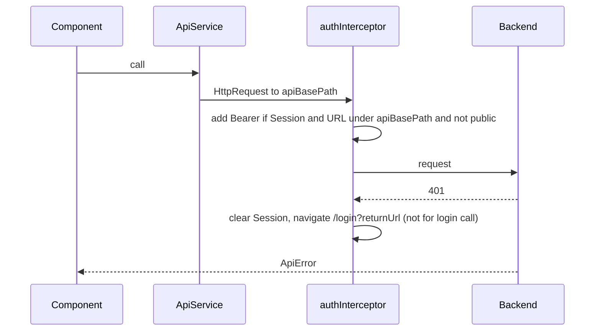

# Design Document

## Overview

The Skeleton Frontend is an Angular single-page application in `skeleton/frontend/`. It renders any published App_Definition served by the Skeleton Backend. It holds no app-specific field, status, step, role or entity code. Everything shown (forms, tables, boards, actions, status colours, branding) comes from the definition projections and from record and instance data returned by the API.

Key design decisions:

| Decision | Rationale |
|---|---|
| Standalone components, signals, zoneless-friendly `OnPush` | Matches repository steering and requirement 1.1. |
| NG-ZORRO is the only UI kit. Theming swaps NG-ZORRO's prebuilt `ng-zorro-antd.dark.css` / `ng-zorro-antd.css` through a `<link>` element, dark by default | NG-ZORRO 22 has no dark algorithm; the prebuilt stylesheets are the supported route. Requirements 1.2 and 6.1 to 6.2. |
| App `primaryColor` is applied only as the CSS custom property `--sk-primary`, read by a small Primary_Override stylesheet on branded surfaces | The colour never touches NG-ZORRO's global theme, so the rest of the UI keeps its tested contrast. Requirement 6.5. |
| Pure logic lives in plain TypeScript functions (`core/pure/`) | Error mapping, SLA state, host resolution, contrast, type conversion, rule resolution and the builder model are testable with fast-check and no TestBed. |
| Dynamic_Form is split into a pure "form model" layer and a thin component | The property tests of requirements 18 and 19 run over the model layer and one TestBed render pass. |
| One `ApiService` holds every backend call | Requirement 17.2. No fallbacks for Backend_Dependencies. |
| Runtime config loaded by `provideAppInitializer` using `fetch` | Requirement 21.1 and 21.8: no build-time import, loaded before the first navigation. |
| Reactive Forms for the Dynamic_Form, signals for state around it | Reactive Forms give validators, disabled state and server errors per control. Signals expose values and validity (requirement 7.1). |
| Widgets resolved through `FIELD_WIDGETS` multi-token | Requirement 8; apps add widgets without touching the skeleton. |
| fast-check pinned exactly, run inside the test runner the Angular 22 CLI generates, in single-run mode | Requirement 18.1. The implementer reads the runner and its version from the generated `package.json` and `angular.json` and pins it exactly. |
| Display names go through one pure helper `displayName(name, id)` | Requirements 9.13, 10.4, 11.3, 11.16 (BD-8): show the name, fall back to the id. |

Framework versions (all exact, no ranges): Angular 22.2.x (`@angular/*`), `ng-zorro-antd` 22.2.0 (peer-compatible with Angular 22), `@angular/cdk` 22.2.x, `fast-check` 4.10.x. "x" is resolved to the exact patch at install time with `npm view <package> versions` and then written to `package.json` as a full version such as `22.2.3`, never as a range. The test runner and its related packages are whatever `ng new` generates for Angular 22; the implementer reads them from the generated `package.json` and `angular.json`, pins them exactly, and runs fast-check inside that runner. The design uses only APIs that are stable across recent releases (standalone, signals, `provideRouter`, `provideHttpClient(withInterceptors)`, `provideAppInitializer`, `@if/@for` control flow).

## Architecture

### Module layout

```
skeleton/frontend/
  package.json, package-lock.json, angular.json, tsconfig*.json, proxy.conf.json
  Dockerfile, nginx.conf, .dockerignore
  public/assets/config.json            runtime config (default: localhost mapping)
  src/
    main.ts, app.config.ts, app.routes.ts, styles.scss
    app/
      core/
        config/        runtime-config.service.ts, host-resolver.ts (pure)
        auth/          session.service.ts, auth.interceptor.ts, auth.guard.ts, admin.guard.ts
        api/           api.service.ts, api.types.ts, api-error.ts
        pure/          error-mapper.ts, sla.ts, contrast.ts, value-codec.ts, field-rules.ts, rule-messages.ts, display-name.ts
        theme/         theme.service.ts, theme-tokens.ts, primary-override.scss
        definition/    definition.store.ts (signals: restricted definition per app)
      shared/
        widgets/       field-widget.token.ts, field-widget.types.ts
        status-chip/, sla-badge/, error-alert/, empty-state/
      features/
        login/         login.page.ts
        public-form/   public-form.page.ts
        shell/         shell.component.ts, app-home.component.ts
        views/         dynamic-table/, kanban/, my-tasks/, view-host.page.ts
        record/        record-detail.component.ts, action-dialog.component.ts, history-timeline.component.ts
        form/          dynamic-form.component.ts, form-model.ts (pure builder), field-control.component.ts
        admin/         admin-shell, definitions-list, json-editor, form-builder/, builder-model.ts (pure)
        errors/        not-found.page.ts, not-authorised.page.ts, config-error.page.ts, no-app.page.ts
```

### Runtime flow

```mermaid
flowchart TD
    A[Browser loads index.html] --> B[APP_INITIALIZER: fetch assets/config.json]
    B -->|invalid| E[Config error page, no routing]
    B -->|valid| C[Router first navigation]
    C --> D{Route}
    D -->|/| R[resolveDefaultApp host] --> S[/app/:app]
    D -->|/public/:app/:form| P[Public form page, no session]
    D -->|/login| L[Login page]
    D -->|/app/:app/**| G[authGuard] --> H[Shell loads Restricted_Definition]
    H --> V[view host: TABLE / KANBAN / MY_TASKS]
    H --> RD[Record detail]
    D -->|/admin/**| AG[adminGuard] --> AD[Admin area]
```

### Routes

| Route | Component | Guard |
|---|---|---|
| `/` | redirect component using `resolveDefaultApp` | none |
| `/login` | LoginPage | none |
| `/public/:app/:form` | PublicFormPage | none |
| `/app/:app` | ShellComponent (children below) | authGuard |
| `/app/:app` (index) | AppHomeComponent (redirect to first view or empty state) | |
| `/app/:app/views/:view` | ViewHostPage | |
| `/app/:app/forms/:form/new` | AuthedFormPage (New menu) | |
| `/app/:app/records/:entity/:id` | RecordDetailComponent | |
| `/admin` | AdminShell (children: list, editor) | authGuard, adminGuard |
| `**` | NotFoundPage | |

The explicit `:app` value always wins over the Default_App (requirement 21.7).

### Request pipeline



The interceptor adds the token only to requests whose URL starts with the configured `apiBasePath` (requirement 2.5, 20.4). The public subset request goes out without a header (requirement 4.2); the interceptor skips URLs under `{base}/public/`.

## Components and Interfaces

### Runtime configuration (Requirement 21)

```ts
export interface RuntimeConfig {
  apiBasePath?: string;
  hosts: Record<string, string>;
}

/** Pure. host may contain upper case and a port. Returns the app code or null. */
export function resolveDefaultApp(hosts: Record<string, string>, host: string): string | null;
```

`resolveDefaultApp` strips a trailing `:port`, lower-cases the host, and does an own-property exact match on lower-cased keys. `RuntimeConfigService.load()` runs from `provideAppInitializer`; it uses `fetch('assets/config.json', { cache: 'no-store' })`, validates that the result is a JSON object whose `hosts` is an object with string values, and stores it in a signal. On failure it sets `configError` and the root component renders ConfigErrorPage; the router is not started (`withDisabledInitialNavigation()` plus a manual `router.initialNavigation()` after success). `apiBase` is a computed signal that defaults to `/api` (requirement 1.6).

### Session (Requirement 2)

```ts
export interface Session { token: string; expiresAt: number; userId: string; displayName: string; roles: string[]; }

class SessionService {
  readonly session: Signal<Session | null>;
  readonly roles: Signal<string[]>;
  readonly isPlatformAdmin: Signal<boolean>;   // roles includes ADMIN_ROLE
  login(username, password): Observable<Session>;   // POST login then GET me
  restore(): Observable<void>;                       // from sessionStorage, GET me
  clear(): void;
}
export const ADMIN_ROLE = 'PLATFORM_ADMIN';          // the only app-code constant (req 1.8)
```

`expiresAt` is `Date.now() + expiresInSeconds * 1000`. The storage key is one constant. Restore discards the value when JSON parsing fails, shape checks fail, or `expiresAt <= Date.now()`. Only `sessionStorage` is used. User id, name and roles are overwritten from `/auth/me` (2.2, 2.3, 2.9). `restore()` also runs in the app initializer after the config.

### ApiService (Requirement 17.2)

All endpoints in the requirements table are methods on `ApiService`. It returns typed observables and maps `HttpErrorResponse` to `ApiError` through `toApiError()`.

```ts
class ApiService {
  login(u: string, p: string): Observable<LoginResponse>;
  me(): Observable<MeResponse>;
  publicApp(app: string): Observable<PublicSubset>;
  definition(app: string, version?: number): Observable<RestrictedDefinition>;
  submitForm(app: string, form: string, body: Record<string, unknown>): Observable<SubmitResult>;
  listRecords(app: string, entity: string, q: ListQuery): Observable<Page<RecordSummary>>;
  getRecord(app: string, entity: string, id: string): Observable<RecordSummary>;
  getInstance(id: string): Observable<InstanceView>;
  runAction(id: string, code: string, body: ActionBody): Observable<InstanceView>;
  history(id: string): Observable<HistoryEntry[]>;
  // admin
  definitionApps(): Observable<string[]>;
  definitionVersions(app: string): Observable<VersionRef[]>;
  validateDefinition(text: string): Observable<ValidatorReport>;
  createDefinition(text: string): Observable<VersionRef>;
  updateDefinition(id: string, text: string): Observable<VersionRef>;
  editPublished(app: string, base: string, text: string): Observable<VersionRef>;
  getDefinition(id: string): Observable<string>;
  definitionInfo(id: string): Observable<VersionRef>;
  publish(id: string): Observable<VersionRef>;
}
```

Details:
- `ListQuery { page, size, sort?, view, filters: Record<string,string> }`. Page is 1-based in the UI. The backend list contract (`page`, `size`, `sort`) is passed through as documented in the requirements table; empty filter values are dropped.
- `validateDefinition` and `createDefinition` send the raw editor text with `Content-Type: application/json` so that the backend reports `line` and `column` for malformed JSON (requirement 12.10).
- `toApiError()` returns `{ status: 0, code: 'NETWORK', ... }` when there is no response, so the UI can offer a retry (20.1).

### Error handling helpers (Requirements 12, 20)

```ts
export interface Violation { field: string; rule: string; message?: string; }
export interface ApiError { status: number; code: string; message: string; requestId?: string; violations: Violation[]; line?: number; column?: number; }

export interface MappedErrors {
  byControl: Record<string, string[]>;   // key present for every control name, possibly []
  unmatched: string[];                   // messages of violations with no control
}
export function mapErrors(err: ApiError, controlNames: readonly string[]): MappedErrors;
export function violationMessage(v: Violation): string;   // message ?? RULE_MESSAGES[rule] ?? rule
```

`mapErrors` walks `err.violations` once, in order. For each violation, if `field` is in the name set the message is pushed on `byControl[field]`, else on `unmatched`. Counts are preserved by construction (12.6). It is pure and deterministic (19.9). `violationMessage` never returns an empty string: when `message` is blank and the rule is blank, it returns `'Invalid value'`.

`ErrorAlertComponent` shows `unmatched` messages, or `message` for errors without violations, and a generic text plus `requestId` for status >= 500 (12.9). A `retry` output is shown for status 0.

### Dynamic_Form (Requirements 7, 8, 12, 18)

The form is built in two layers.

**Layer 1: pure model (`form-model.ts`, `field-rules.ts`, `value-codec.ts`)**

```ts
export type FieldRule = 'hidden' | 'readonly' | 'optional' | 'required';
export type FieldType = 'TEXT'|'TEXTAREA'|'NUMBER'|'DECIMAL'|'DATE'|'DATETIME'|'BOOLEAN'
  |'SELECT'|'MULTISELECT'|'FILE'|'USER'|'REFERENCE'|'EMAIL'|'PHONE'|'LOCATION';

export interface FieldDef {
  code: string; label: string; type: FieldType; required?: boolean; help?: string; default?: unknown;
  options?: { value: string; label: string }[]; ref?: string;
  min?: number; max?: number; maxLength?: number; pattern?: string; accept?: string; maxFiles?: number;
  widget?: string;
}
export interface SectionDef { title?: string; columns?: 1|2|3; fields: string[]; }

/** effective rule: rules[code] when a map is supplied and holds the code, otherwise required/optional from def. */
export function effectiveRule(f: FieldDef, rules?: Record<string, FieldRule>): FieldRule;

export interface ControlPlan {
  code: string; field: FieldDef; rule: FieldRule;
  rendered: boolean;      // rule !== 'hidden'
  disabled: boolean;      // rule === 'readonly' || type === 'FILE'
  validators: ValidatorKind[];   // subset of 'required'|'maxLength'|'min'|'max'|'pattern'|'email'
  submitted: boolean;     // rule in optional|required and type !== FILE
}
export function planControls(fields: FieldDef[], rules?: Record<string, FieldRule>): ControlPlan[];

export function collectValues(plan: ControlPlan[], raw: Record<string, unknown>): Record<string, unknown>;
export function isEmptyValue(v: unknown): boolean;   // undefined, null, '', [] , {lat:null,lng:null}
```

Rules for `planControls`:
- `required` validator only when rule is `required` and type is not FILE.
- `maxLength`, `min`, `max`, `pattern` validators exactly when the definition declares them (`maxLength` and `pattern` are attached as declared; they apply to the control regardless of type, as the requirement states). `email` validator for EMAIL.
- `accept` and `maxFiles` are ignored (7.14).
- `collectValues` keeps a key only when `submitted` and the value is not empty (7.8, 7.9, 18.6).

`value-codec.ts` converts UI input to JSON types (7.17):

```ts
export function toJsonValue(type: FieldType, ui: unknown): unknown;     // NUMBER/DECIMAL -> number, DATE -> 'yyyy-MM-dd', DATETIME -> ISO-8601 with offset, BOOLEAN -> boolean, MULTISELECT -> string[], LOCATION -> {lat,lng}
export function fromJsonValue(type: FieldType, json: unknown): unknown; // inverse, for initial values
```

DATETIME output uses the local UTC offset (`2026-03-05T14:30:00+05:30`) so that the instant is preserved. `Z` is used when the offset is zero.

**Layer 2: component**

```ts
@Component({ selector: 'sk-dynamic-form', standalone: true, changeDetection: OnPush, ... })
class DynamicFormComponent {
  fields = input.required<FieldDef[]>();
  sections = input<SectionDef[]>();
  rules = input<Record<string, FieldRule>>();
  initial = input<Record<string, unknown>>();
  disabled = input(false);
  serverError = input<ApiError | null>(null);
  readonly values: Signal<Record<string, unknown>>;   // collectValues over the live form, JSON-typed
  readonly valid: Signal<boolean>;
  readonly unmatchedErrors: Signal<string[]>;
  submitted = output<Record<string, unknown>>();
  submit(): void;      // invalid -> markAllAsTouched, no emit
}
```

Behaviour:
- A `FormGroup` is rebuilt from `planControls` whenever `fields`, `rules` or `initial` change; current values for unchanged codes are retained.
- Only rendered controls are in the group (hidden fields have no control). FILE gets a disabled control and a hint text "File upload is not yet available".
- Layout: sections in order; `columns` becomes a CSS grid (`nz-row`/`nz-col` spans 24/12/8); below 576 px every section is one column. When `sections` is absent, one untitled section with all non-hidden fields in field order.
- `FieldControlComponent` switches on `type` (and consults the widget registry first). Built-in controls: `nz-input`, `nz-input` textarea, `nz-input-number`, `nz-date-picker` (date), `nz-date-picker` with `nzShowTime`, `nz-switch`, `nz-select`, `nz-select` multiple, `nz-input` type email / tel, two `nz-input-number` for latitude and longitude. USER and REFERENCE use a text input for the id value since the requirements define no lookup endpoint.
- Every control has a label bound with `for`/`id` or `aria-label`; the `help` text is shown with `nz-form-extra`.
- Server errors: when `serverError` changes, `mapErrors` runs over the names of rendered controls. Matched controls get `setErrors({ server: messages })`, are marked touched, and show messages in an element referenced by `aria-describedby`, with `aria-invalid="true"`. Unmatched go to `unmatchedErrors` for the form-level alert. A `valueChanges` subscription per control removes the `server` error when the user edits it (12.8).
- Controls are given explicit pixel heights of at least 44 px under 576 px viewport (4.11) via a CSS class on the public page.

### Widget registry (Requirement 8)

```ts
export interface FieldWidgetContext { field: FieldDef; control: FormControl; rule: FieldRule; disabled: boolean; }
export interface FieldWidgetComponent { /* inputs: field, control, rule, disabled (signal inputs) */ }
export interface FieldWidgetRegistration { key: string; component: Type<unknown>; }
export const FIELD_WIDGETS = new InjectionToken<FieldWidgetRegistration[]>('FIELD_WIDGETS');
```

`WidgetRegistry` injects `FIELD_WIDGETS` (optional, multi). At construction it builds a `Map` keeping the first registration per key and logs `console.error` naming the key for each duplicate (8.4). `FieldControlComponent` picks `registry.get(field.widget)` only from the `widget` string of the field (8.6) and falls back to the built-in control when the key is missing or unregistered (8.5). The widget is created with `NgComponentOutlet` and signal inputs `field`, `control`, `rule`, `disabled`.

### Theme and accessibility (Requirement 6)

- **Theme files.** NG-ZORRO's prebuilt `ng-zorro-antd.css` (light) and `ng-zorro-antd.dark.css` (dark) are copied as assets by `angular.json` (for example `public/assets/themes/light.css` and `dark.css`, copied from `node_modules/ng-zorro-antd`). They are not listed in the `styles` array, so they are not part of the main bundle and load on demand. NG-ZORRO 22 has no dark algorithm and `NzConfigService` is not used for theming.
- `ThemeService` computes the active mode from `app.branding.theme`: `dark` is the default, `light`, and `auto` follows `matchMedia('(prefers-color-scheme: dark)')`. It owns one `<link id="sk-theme" rel="stylesheet">` element in `<head>`. `apply(mode)` sets its `href` to the dark or light file and sets `data-theme` on `<html>`; the first paint waits for the `load` event of the link (no flash of the wrong theme). For `auto` it registers a `change` listener on the media query and swaps the `href` when the browser setting changes; the listener is removed when another mode is applied. The pure function `resolveTheme(mode, prefersDark): 'dark' | 'light'` carries the decision and is unit tested.
- **Primary_Override.** `primary-override.scss` is a small global stylesheet that reads `var(--sk-primary)` and applies it to Branded_Surfaces only: the header, primary buttons (`.ant-btn-primary`), the focus ring, Kanban column headers and status chips. Each of these also reads `--sk-on-primary`, the text colour for that background. `ThemeService.applyBranding(primaryColor?)` sets `--sk-primary` and `--sk-on-primary = onColor(primaryColor)` on `<html>`, or removes both when the app defines no colour so the defaults apply. Nothing else in NG-ZORRO is recoloured, and no call to `NzConfigService` is made.
- `onColor(bg)` in `contrast.ts` returns `#000000` or `#ffffff`, whichever has the higher contrast ratio against `bg`, and is the only way text colour on a Branded_Surface is chosen (6.5). Status chips and Kanban headers coloured by a status `color` from the definition use the same helper for their text colour.
- `theme-tokens.ts` exports the token table of foreground/background pairs for the dark and the light prebuilt themes, plus the Skeleton Key accent, with the required minimum (4.5 for text, 3 for large text and component borders). A unit test iterates all pairs (6.8). The orange accent (for example `#ff7a1a`) is used for highlights only, never for text with insufficient contrast; it is checked in the same test. The same test also checks `onColor` against a sample of primary colours.
- Global focus ring style via `:focus-visible` with a 2 px outline coloured by `--sk-primary` (default accent when unset) at 3:1 contrast against the surface. Icon-only buttons and status chips carry `aria-label`; chips always include the text.
- Logo URLs are accepted by `safeLogoUrl(url)` only if the scheme is `http`, `https`, or the value is a same-origin relative path (20.6).

### Shell (Requirement 5)

`ShellComponent` reads `:app`, calls `DefinitionStore.load(app)` and shows a spinner while pending. On 404 or 409 it shows "app not available" and no menu. The menu is the `views` in order (label or code), then a "New" entry per form the user can submit (form `roles` intersects user roles, or form `public`), then "Admin" for a Platform_Admin. Header: logo (if safe), app name, display name, Sign out. After the definition loads, the Shell calls `ThemeService.apply(branding.theme)` and `ThemeService.applyBranding(branding.primaryColor)`, which sets `--sk-primary` for the Primary_Override (requirement 5.5). The header, primary buttons, focus ring, Kanban column headers and status chips read it; text on them uses `--sk-on-primary` from `onColor`. `StatusChip` takes `label` and `color`, renders the label text always, and uses `onColor(color)` for its text colour. `AppHomeComponent` redirects to the first view, or shows an empty state.

### View renderers (Requirements 9, 10)

`ViewHostPage` finds the view in the Restricted_Definition and switches on `view.type`.

**DynamicTableComponent**
```ts
inputs: app, view, entity (EntityDef), workflow? (for status colour fallback not needed)
state signals: page, size, sort, filters, loading, result, listError
```
- Columns: `view.columns` or `[titleField?, '$reference']`. Field columns use `FieldDef.label`; `$` columns use a fixed label map. `formatCell(field, value)` is a pure function (option labels, localised dates, Yes/No, plain text).
- Changes to page, size, sort or filters call `listRecords` through a single `effect`/`switchMap` pipeline; sort or filter changes reset page to 1. `defaultSort` seeds the sort state.
- Filters: one control per `view.filters` entry, chosen by field type (select for SELECT, switch/select for BOOLEAN, date picker for DATE, text otherwise); `$` filter columns use a text input. Non-empty values become equality params named after the field code.
- 400 with violations: show messages above the table, keep previous rows. Empty result shows an empty state. Row click navigates to `/app/:app/records/:entity/:id`.
- `$status` renders `StatusChip(status, statusColor)`, `$step` renders `stepLabel`, `$assignee` renders `displayName(assigneeName, assignee)`, `$dueAt` renders date plus `SlaBadge`. The status chip takes its text colour from `onColor(statusColor)`.

**KanbanComponent**
- Columns come from `statuses` of the first workflow of the Restricted_Definition whose `entity` equals the view entity. Cards are placed by comparing `status` with column labels; unmatched go to an "Other" column that appears only when non-empty.
- Loads pages with `listRecords(view=code, page, size=50)` and shows "Load more" while `total > loaded`. No drag behaviour.
- `groupByStatus(records, statuses)` is a pure function.
- Each card shows `$reference`, the `titleField` value when present, the assignee as `displayName(assigneeName, assignee)` when either is present, and the status chip. Column headers are Branded_Surfaces: the header background is the status `color` when declared (otherwise `--sk-primary`) and its text uses `onColor` of that background; the status label text is always shown.

**MyTasksComponent**
- Uses `listRecords` with `sort=$dueAt,asc` unless the view declares `defaultSort`. Shows reference, title, `stepLabel`, status chip and due date with `SlaBadge`.

**SLA (Requirement 10.12 to 10.15)**
```ts
export const WARNING_WINDOW_MS = 24 * 3600 * 1000;
export type SlaState = 'NONE' | 'DUE_SOON' | 'OVERDUE';
export function slaState(dueAt: string | null | undefined, now: Date, windowMs: number, ended: boolean): SlaState;
```
`SlaBadge` renders an icon plus text ("Overdue" or "Due soon") and nothing for `NONE`. `ended` records and missing or unparseable `dueAt` give `NONE`.

### Record_Detail (Requirement 11)

```ts
class RecordDetailComponent {
  // route params: app, entity, id
  record = signal<RecordSummary | null>(null);
  instance = signal<InstanceView | null>(null);
  history = signal<HistoryEntry[]>([]);
}
```
- Loads the record, then (when `instanceId` is not null) the instance view and history in parallel. A null `instanceId` renders the fields with `required` from the entity and no actions or history (11.18).
- The header block shows `$reference`, `stepLabel`, the status chip, the assignee as `displayName(instance.assigneeName, instance.assignee)` and `dueAt` with `SlaBadge` (11.3).
- Fields go through `<sk-dynamic-form [fields] [rules]="instance.fieldRules" [initial]="record.data">`.
- Action buttons follow `instance.actions` order and `style` (`primary`, `default`, `danger` mapped to `nzType` and `nzDanger`). All are disabled while a request is pending. An ended instance shows a "Closed" tag and no buttons.
- `ActionDialogComponent` is opened when `remarks` or `attachment` is not `hidden`; the confirm button is disabled by `actionDialogReady(action, remarks, attachment)` (pure). An action with a `confirm` text, and no dialog, uses `NzModalService.confirm`; when the dialog is shown the confirm text is displayed in it.
- The request body carries `fields` (only changed, editable values from `collectValues`, diffed against initial JSON values), and `remarks` and `attachment` when non-blank.
- Success: set the returned Instance_View, reload record and history, `NzMessageService.success`. 422/403 with violations: apply to form controls through `serverError` and to the dialog inputs named `remarks`/`attachment`; the dialog stays open. 409: show message, reload instance, keep field values. 5xx: generic message with `requestId`. 404: NotFound page with app-home link.
- `HistoryTimelineComponent` uses `nz-timeline`, with time, kind, action code, from/to step, from/to status, the actor as `displayName(actorName, actorId)` and remarks, in backend order. All text is interpolated, never bound to `innerHTML` (20.5).

### Public form page (Requirement 4)

`PublicFormPage` calls `publicApp(app)` without a session. It picks the form by code and builds `FieldDef[]` from the Public_Subset fields it lists. Missing form, 404 or 409 give "form not available". Submit sends `collectValues` output. 201 swaps the form for a confirmation with `referenceNo`; 422/400 uses the `serverError` input; 5xx or no response shows a generic error with `requestId`. Branding is applied from `app.branding` of the subset.

### Login page (Requirement 3)

Reactive form with `username` and `password`. Blank values show a field message and send nothing. 401 shows one neutral message. 400 with violations go through `mapErrors` onto `username`/`password`. Success navigates to the stored `returnUrl` or `/app/<defaultApp>`. The button is disabled while pending.

### Admin area (Requirements 13, 14, 15)

- `adminGuard` requires `ADMIN_ROLE`; otherwise it navigates to the NotAuthorised page. A 403 from any admin call shows the same message.
- **Definitions list**: loads `definitionApps()`; picking an app loads `definitionVersions(app)` into a table (version, status, hash, id). Opening a version loads `getDefinition(id)` into the editor; New definition opens a template from `minimalDefinitionTemplate()` (a constant that satisfies the schema's required top-level properties).
- **JsonEditorComponent**: a monospaced `textarea` bound to a signal. `JSON.parse` on each change: parse error shown and Save disabled. After 500 ms of no change (RxJS `debounceTime` on a `toObservable` of the text, `switchMap` to cancel stale calls) `validateDefinition` runs and the Validator_Report is displayed as a list (`field`, `rule`, `message`). Clicking a violation whose `field` is a JSON Pointer calls `pointerToOffset(text, pointer)` and sets the textarea selection. A 400 with `line` and `column` shows them and uses `lineColumnToOffset(text, line, column)` to move the caret.
- Save picks the endpoint from state: new → POST, DRAFT → PUT, PUBLISHED → edit. Publish is enabled only for a saved DRAFT with no unsaved changes. 422 shows the report; 409 on publish shows the message. A `canDeactivate` guard asks for confirmation with unsaved changes.
- **Form_Builder** (see below) is a panel beside the editor that reads and writes the editor text.

### Form builder (Requirement 15)

```ts
export interface BuilderModel {
  entityCode: string;
  formCode: string | null;           // null = new form
  fields: FieldDef[];                // entity fields, order preserved
  sections: SectionDef[];            // selected form layout
}

export function extractModel(def: AppDefinitionJson, entityCode: string, formCode: string | null): BuilderModel;
export function applyModel(def: AppDefinitionJson, model: BuilderModel): AppDefinitionJson;  // touches only that entity's fields and that form's sections
export function generateFieldCode(existing: string[], base?: string): string;
export function validateFieldCode(code: string, existing: string[], selfCode?: string): string | null;  // error text or null
export function validateField(f: FieldDef, entityCodes: string[]): string[];   // options for SELECT, ref for REFERENCE
export function moveField(section: SectionDef, from: number, to: number): SectionDef;
```

- `applyModel` returns a new object; all other keys and entities are untouched (15.10). Only schema-defined properties are written; properties that are `undefined` are removed so the JSON stays schema-valid (15.9).
- The builder UI uses Angular CDK `DragDrop` (part of the Angular ecosystem, not a second UI kit) plus move-up/move-down buttons with `aria-label`. Delete from entity asks for confirmation (`nz-popconfirm`).
- The live preview is `<sk-dynamic-form [fields]="previewFields()" [sections]="model().sections">` driven by computed signals from the same model (15.8).
- Field code is validated against `^[a-z][a-zA-Z0-9_]{0,63}$` and uniqueness; invalid input shows an error and is not applied (15.12).

### Production build (Requirement 16)

`Dockerfile`:
```
FROM node:<lts-pinned> AS build
WORKDIR /src
COPY package.json package-lock.json ./
RUN npm ci
COPY . .
RUN npm run build -- --configuration production
FROM nginx:<pinned>-alpine
COPY nginx.conf /etc/nginx/conf.d/default.conf
COPY --from=build /src/dist/skeleton-frontend/browser /usr/share/nginx/html
```
The output path is confirmed against `angular.json` at implementation time.

`nginx.conf` highlights:
- `location /api/ { proxy_pass http://app:8080; proxy_set_header Host $host; proxy_set_header X-Request-Id $request_id; }`
- `location = /index.html { add_header Cache-Control "no-cache"; }` and `location = /assets/config.json { add_header Cache-Control "no-cache"; }`
- hashed assets: `location ~* \.(js|css|woff2?|svg|png|ico)$ { add_header Cache-Control "public, max-age=31536000, immutable"; }`
- `location / { try_files $uri $uri/ /index.html; }`
- server-level `add_header X-Content-Type-Options "nosniff" always;` and `add_header X-Frame-Options "DENY" always;` (nginx drops parent `add_header` in locations that define their own, so each location repeats both security headers through an `include security-headers.conf`).

`docker-compose.yml` adds:
```yaml
  frontend:
    build: ./skeleton/frontend
    restart: unless-stopped
    ports: ["${FRONTEND_PORT:-80}:80"]
    depends_on:
      app: { condition: service_healthy }
    volumes:
      - ./skeleton/frontend/public/assets/config.json:/usr/share/nginx/html/assets/config.json:ro
    healthcheck:
      test: ["CMD", "wget", "-q", "--spider", "http://127.0.0.1/"]
      interval: 15s
      timeout: 5s
      retries: 5
```
The existing compose file is read and extended in place at implementation time; the service name `app` is the one stated in the requirements.

### Commands (Windows CMD)

```
cd skeleton\frontend
npm ci
npm run start
npm run build
npm run test
npm run lint
```
`test` must run once (`ng test --watch=false` or the runner's single-run flag) so it never blocks. `lint` uses `ng lint` with ESLint. No shell-specific syntax appears in package scripts. Files are written as UTF-8 without BOM, LF endings, enforced by `.editorconfig` (`end_of_line = lf`, `charset = utf-8`) and `.gitattributes`.

## Data Models

TypeScript types mirror the API and the schema. They live in `core/api/api.types.ts` and `features/form/form-model.ts`.

```ts
export interface LoginResponse { token: string; tokenType: string; expiresInSeconds: number; userId: string; displayName: string; roles: string[]; }
export interface MeResponse { userId: string; displayName: string; roles: string[]; }

export interface Branding { primaryColor?: string; logo?: string; theme?: 'light' | 'dark' | 'auto'; }
export interface AppInfo { code: string; name: string; description?: string; branding?: Branding; }

export interface PublicSubset { app: AppInfo; forms: FormDef[]; entities?: { code: string; fields: FieldDef[] }[]; }

export interface FormDef { code: string; label?: string; entity: string; public?: boolean; roles?: string[]; startsWorkflow?: string; sections: SectionDef[]; fields?: FieldDef[]; }
export interface ViewDef { code: string; label?: string; type: 'TABLE'|'KANBAN'|'MY_TASKS'; entity: string; columns?: string[]; filters?: string[]; defaultSort?: { field: string; direction?: 'ASC'|'DESC' }; scope?: string; }
export interface EntityDef { code: string; label: string; titleField?: string; referencePrefix?: string; fields: FieldDef[]; }
export interface StatusDef { label: string; category: string; color?: string; }
export interface StepPresentation { code: string; label?: string; type: string; }
export interface WorkflowPresentation { code: string; label?: string; entity: string; statuses: StatusDef[]; steps: StepPresentation[]; }
export interface RestrictedDefinition { app: AppInfo; roles: { code: string; label: string }[]; entities: EntityDef[]; forms: FormDef[]; views: ViewDef[]; workflows: WorkflowPresentation[]; }

export interface RecordSummary {
  id: string; data: Record<string, unknown>; referenceNo: string;
  instanceId: string | null; step?: string; stepLabel?: string; status?: string; statusColor?: string;
  assignee?: string | null; assigneeName?: string | null;   // assigneeName: BD-8, backend-ui-support spec
  dueAt?: string | null; ended?: boolean;
}
export interface Page<T> { items: T[]; page: number; size: number; total: number; sort?: string; }

export interface ActionInfo { code: string; label: string; style: 'primary'|'default'|'danger'; confirm?: string; remarks: 'hidden'|'optional'|'required'; attachment: 'hidden'|'optional'|'required'; }
export interface InstanceView { instanceId: string; recordId: string; step: string; status: string; ended: boolean; dueAt?: string | null; assignee?: string | null; assigneeName?: string | null; actions: ActionInfo[]; fieldRules: Record<string, FieldRule>; }
export interface ActionBody { fields: Record<string, unknown>; remarks?: string; attachment?: string; }
export interface HistoryEntry { at: string; kind: string; action?: string; fromStep?: string; toStep?: string; fromStatus?: string; toStatus?: string; actorId?: string; actorName?: string | null; remarks?: string; }   // actorName: BD-8

/** Pure. Name when it has non-blank text, otherwise the id, otherwise '-'. */
export function displayName(name: string | null | undefined, id: string | null | undefined): string;

export interface VersionRef { id: string; version: number; status: 'DRAFT'|'PUBLISHED'; contentHash: string; createdAt?: string; publishedAt?: string; app?: string; }
export type ValidatorReport = Violation[];
```

Field names that the requirements do not fix (for example `data`, `referenceNo` on a record, `at`/`actorId` on history) follow the existing backend DTOs. The implementer reads `skeleton/backend` DTOs and the backend design when creating `api.types.ts` and aligns the names; any mismatch is recorded in that file as a comment instead of being worked around.

Session storage record: `{ token, expiresAt, userId, displayName, roles }` under one key. The return target is held in `sessionStorage` under a second key, cleared after use.

`theme-tokens.ts`:
```ts
export interface TokenPair { name: string; fg: string; bg: string; min: 4.5 | 3; theme: 'dark' | 'light'; }
export const THEME_TOKEN_PAIRS: readonly TokenPair[];
export function contrastRatio(fgHex: string, bgHex: string): number;   // WCAG relative luminance formula
export function onColor(bgHex: string): '#000000' | '#ffffff';
```


## Correctness Properties

_A property is a characteristic or behavior that should hold true across all valid executions of a system, a formal statement about what the system should do. Properties are the bridge between human-readable specifications and machine-verifiable correctness guarantees._

Reflection on redundancy: the controls, disabled, required-validator, limit-validator, submitted-keys and default-rule criteria (7.8 to 7.13, 18.2 to 18.6) all describe one function, `planControls`, and are grouped into Properties 1 to 3 (render/disabled/required, limit validators, submitted values). The error mapping criteria (12.1 to 12.6, 19.2 to 19.6, 19.9) collapse into Properties 5 and 6, with the Dynamic_Form application (12.7, 12.8, 19.7) in Property 7. Cell formatting, columns and query building stay separate because they test different functions. Pointer/line-column and JSON pretty-print are grouped into two properties.

Required and optional properties: the core property tests are **REQUIRED**: Properties 1, 2, 3, 5, 6, 7, 9 and 19. They cover the form renderer, error mapping, Kanban grouping and the form builder round trip, and they back requirements 18 and 19. Every other property (4, 8, 10 to 18, 20 to 22) is kept as a full definition but is an **OPTIONAL** test task: it may be skipped for the first delivery without leaving a requirement uncovered by an example-based test. Property numbers do not change.

| Property | Status |
|---|---|
| 1, 2, 3, 5, 6, 7, 9, 19 | REQUIRED |
| 4, 8, 10, 11, 12, 13, 14, 15, 16, 17, 18, 20, 21, 22 | OPTIONAL |

### Property 1: Controls follow effective rules

*For any* list of field definitions covering the 15 field types, any optional map of Field_Rules, and the rendered Dynamic_Form: exactly one control exists for each field whose effective rule is not `hidden`, no control exists for a `hidden` field; a control is disabled if and only if its effective rule is `readonly` or its type is FILE; and a control carries a required validator if and only if its effective rule is `required` and its type is not FILE. When no rule map is given, the effective rule is `required` for `required: true` fields and `optional` otherwise.

**Validates: Requirements 7.8, 7.9, 7.10, 7.11, 7.12, 18.2, 18.3, 18.4**

### Property 2: Limit validators match declared constraints

*For any* list of field definitions and rule map, a control carries a maximum-length, minimum, maximum or pattern validator if and only if its field declares `maxLength`, `min`, `max` or `pattern` respectively, an email validator if and only if the type is EMAIL, and the presence of `accept` or `maxFiles` changes nothing in the plan.

**Validates: Requirements 7.13, 7.14, 18.5**

### Property 3: Submitted values contain exactly the editable non-empty fields

*For any* field list, rule map and raw value map, `collectValues` returns an object whose keys are exactly the codes of fields whose effective rule is `optional` or `required`, whose type is not FILE, and whose value is non-empty.

**Validates: Requirements 7.4, 7.8, 7.9, 18.6**

### Property 4: Type conversion round trip and JSON types

*For any* field type and valid UI value of that type, `toJsonValue` produces the JSON type required by the type (number for NUMBER and DECIMAL, `yyyy-MM-dd` string for DATE, ISO 8601 string with an offset for DATETIME, boolean for BOOLEAN, string array for MULTISELECT, `{ lat, lng }` for LOCATION), and `fromJsonValue(type, toJsonValue(type, v))` equals `v`.

**Validates: Requirements 7.17**

### Property 5: Error mapping assigns every violation exactly once

*For any* set of control names and any list of Violations (with matching and non-matching `field` values), `mapErrors` places each Violation whose `field` equals a control name in that control's list and in no other list, places every other Violation in the unmatched list, and the number of assigned messages plus unmatched messages equals the number of input Violations.

**Validates: Requirements 12.1, 12.2, 12.5, 12.6, 19.2, 19.3, 19.4**

### Property 6: Error mapping preserves order, yields non-empty messages and is deterministic

*For any* ApiError and control names, Violations sharing a `field` keep their input relative order, every produced message is a non-empty string equal to the Violation `message` when present and to the rule lookup (falling back to the rule code text) otherwise, and mapping the same input twice returns equal results.

**Validates: Requirements 12.3, 12.4, 19.5, 19.6, 19.9**

### Property 7: Applied server errors reach the right controls

*For any* generated field set and ApiError, after the Dynamic_Form applies the error, each matched control is invalid with its messages shown, `aria-invalid` set and `aria-describedby` pointing at the message element, each unmatched Violation appears in the form-level alert, and editing a control that has a server error clears that error.

**Validates: Requirements 12.7, 12.8, 19.7**

### Property 8: SLA state classification

*For any* `dueAt`, current time, Warning_Window and `ended` flag, `slaState` returns `NONE` when `ended` is true or `dueAt` is missing or invalid; otherwise `OVERDUE` when now is later than `dueAt`, `DUE_SOON` when now is not later than `dueAt` and the remaining time is at most the window, and `NONE` otherwise.

**Validates: Requirements 10.12, 10.13, 10.15**

### Property 9: Kanban grouping places every record once

*For any* ordered list of statuses and any list of records, `groupByStatus` places each record in exactly one column, in the column whose label equals its `status` when one exists and in "Other" otherwise, keeps the input order within each column, keeps columns in declaration order, and the total number of placed cards equals the number of input records.

**Validates: Requirements 10.1, 10.3, 10.8**

### Property 10: Table columns and query building

*For any* view, entity and table state, `resolveColumns` returns the view `columns` in order when declared and otherwise the `titleField` (when present) followed by `$reference`; `buildListQuery` includes only non-empty filter values keyed by field code, uses `defaultSort` only when the user has not sorted, and sets `page` to 1 whenever the sort or the filters change.

**Validates: Requirements 9.2, 9.3, 9.6, 9.7, 9.8, 9.9**

### Property 11: Cell formatting is total and label-preserving

*For any* field definition and cell value, `formatCell` returns a string without throwing; for SELECT values that match an option it returns the option label, for MULTISELECT the labels of matched options, and for BOOLEAN "Yes" or "No".

**Validates: Requirements 9.4**

### Property 12: Action dialog readiness and action body

*For any* action definition, remarks and attachment strings, `actionDialogReady` is true if and only if each input whose rule is `required` is not blank; and for any initial and current field values, the built action body `fields` contains exactly the keys of editable fields whose value differs from the initial value, and `remarks` and `attachment` only when non-blank.

**Validates: Requirements 11.7, 11.8, 11.10**

### Property 13: Host resolution

*For any* Host_Mapping and host name, `resolveDefaultApp` returns the mapped app code if and only if the lower-cased host without port equals a lower-cased key of the mapping, and returns null otherwise; and *for any* JSON value, `validateRuntimeConfig` accepts it if and only if it is an object whose `hosts` is an object with string values.

**Validates: Requirements 21.3, 21.4, 21.9**

### Property 14: Contrast helpers

*For any* two hex colours, `contrastRatio` is symmetric and between 1 and 21, and `onColor(bg)` returns the one of black and white whose ratio against `bg` is greater than or equal to the other (this is the text colour used on every Branded_Surface painted with `--sk-primary` or a status colour); and *for every* theme token pair in `THEME_TOKEN_PAIRS` (dark and light prebuilt themes and the accent), the ratio meets its declared minimum (4.5 for text, 3 for large text and component borders). Also, `resolveTheme('auto', prefersDark)` returns `dark` if and only if `prefersDark` is true, and `resolveTheme('dark' | 'light', _)` returns that mode.

**Validates: Requirements 6.4, 6.5, 6.8**

### Property 15: Widget registry keeps the first registration

*For any* list of widget registrations, the registry resolves each key to its first registration, reports one error naming the key for each later duplicate, and resolves an unregistered key to nothing so the built-in control is used.

**Validates: Requirements 8.3, 8.4, 8.5**

### Property 16: Session restore is safe

*For any* stored string and current time, `parseStoredSession` returns a Session if and only if the string is a well-formed Session whose expiry is later than now, and never throws.

**Validates: Requirements 2.3, 2.4**

### Property 17: JSON editor helpers

*For any* JSON value, `formatJson` produces two-space indented text that parses back to an equal value; `jsonState` reports a parse error if and only if `JSON.parse` fails; for any location in the formatted text, `pointerToOffset` returns the offset where the pointed value starts and `lineColumnToOffset` agrees with the line and column of that offset; and the save endpoint choice is POST for new, PUT for DRAFT and edit for PUBLISHED, with Publish enabled only for a saved DRAFT without unsaved changes.

**Validates: Requirements 12.10, 14.1, 14.2, 14.4, 14.5, 14.6, 14.8, 14.12**

### Property 18: Form builder field operations

*For any* list of existing field codes, `generateFieldCode` returns a code that matches `^[a-z][a-zA-Z0-9_]{0,63}$` and is not in the list; `validateFieldCode` returns an error for any code that does not match the pattern or duplicates another code; `validateField` returns an error for SELECT or MULTISELECT without options and for REFERENCE without a target entity; and `moveField` returns a permutation of the same fields, with a move from i to j followed by j to i restoring the original order.

**Validates: Requirements 15.2, 15.3, 15.4, 15.6, 15.12**

### Property 19: Form builder model round trip and isolation

*For any* definition, entity and form, `applyModel(def, extractModel(def, entity, form))` equals `def`; *for any* edited model, `applyModel` leaves every part of the definition outside the selected entity fields and form sections unchanged and writes only schema-defined properties; and serialising the result to JSON, parsing it and extracting the model again yields a model equal to the edited one.

**Validates: Requirements 15.9, 15.10, 15.11**

### Property 20: Safe display helpers

*For any* URL string, `safeLogoUrl` accepts it if and only if its scheme is `http` or `https` or it is a same-origin relative path; and *for any* ApiError with status 500 or more, `errorText` contains the `requestId` when present and never contains the server `message`; and *for any* name and id strings (possibly null, empty or whitespace), `displayName(name, id)` returns `name` when it contains non-whitespace text, otherwise `id` when it contains non-whitespace text, otherwise `-`, and never returns an empty string.

**Validates: Requirements 9.13, 10.4, 11.3, 11.16, 12.9, 20.6**

### Property 21: Menu construction

*For any* Restricted_Definition and user roles, `buildMenu` returns one entry per view in declaration order labelled with the view `label` or else its `code`, followed by one "New" entry per submittable form, and an "Admin" entry if and only if the roles include `PLATFORM_ADMIN`.

**Validates: Requirements 5.2, 5.3, 5.9**

### Property 22: Initial values and section layout

*For any* field list, initial values and sections, the initial value of each field is the supplied initial value when present, else the field `default`; and when no sections are supplied, `layoutSections` returns one single-column section holding all non-hidden fields in field order.

**Validates: Requirements 7.6, 7.15**

## Error Handling

| Situation | Behaviour |
|---|---|
| No HTTP response (status 0) | `ApiError` with `NETWORK` code; "cannot reach server" alert with Retry (20.1). |
| 401 (not login) | Interceptor clears Session, navigates to `/login` with `returnUrl` (2.6). |
| 401 on login | One neutral message (3.3). |
| 400/422 with violations | `mapErrors` onto controls; unmatched shown in the form-level alert (12). |
| 400 with `line`/`column` | Editor shows position and moves caret (12.10). |
| 403 | Show the `message`, stay on page; admin screens show "not authorised" (20.2, 13.7). |
| 404 on record/instance | NotFound page with link to app home (20.3). |
| 404/409 on definition | "app not available" or "form not available" (4.4, 5.7). |
| 409 on action | Show message, reload instance, keep field values (11.13). |
| 5xx | Generic text plus `requestId`; server detail never shown (11.14, 12.9). |
| Runtime config invalid | ConfigErrorPage, no routing (21.3). |
| Unknown host | NoAppPage with app-code input (21.6). |
| Unparseable JSON in editor | Parse error shown, Save disabled (14.2). |
| Backend_Dependency missing | The call fails and shows its error; no fallback is coded (17.1). |

A single `HttpErrorResponse` to `ApiError` conversion (`toApiError`) tolerates non-JSON bodies (nginx 502 pages) by returning a generic 5xx `ApiError` with an empty violation list. All definition-provided text is rendered with Angular interpolation, no `[innerHTML]`, and a lint rule (`no-restricted-syntax` on `innerHTML` bindings) enforces it (20.5). The Frontend sends no data to hosts other than its origin: all API URLs are relative to `apiBasePath`, and the interceptor attaches the token only for that prefix (20.4).

## Testing Strategy

### Property-based testing applies, partly

The pure logic (rule planning, error mapping, conversion, SLA, grouping, host resolution, contrast, builder model, JSON helpers) is well suited to property-based testing. UI rendering, HTTP wiring, Nginx and Docker are not: they use example-based component tests, smoke checks and integration checks.

### Tooling

- Library: **fast-check**, pinned to an exact version (no `^`/`~`), version 4.10.x resolved to an exact patch with `npm view fast-check versions` at install time. It runs inside the unit test runner that the Angular 22 CLI generates: the implementer reads the runner and its packages from the generated `package.json` and `angular.json`, pins them exactly, and writes the fast-check tests as ordinary specs of that runner. Other pins are Angular 22.2.x, `ng-zorro-antd` 22.2.0 and `@angular/cdk` 22.2.x, all exact.
- Single-run command, identical in Windows CMD and Linux: `npm run test` which maps to `ng test --watch=false` (adding `--browsers=ChromeHeadless` only if Karma is the runner). No watch mode is used in verification.
- Every property test runs at least 100 cases (`{ numRuns: 100 }` or more) and prints the seed and shrunk counterexample on failure (`verbose: true`, `reporter` logging `seed` and `counterexample`).
- Each property is implemented by exactly one `fc.assert(fc.property(...))` test, tagged with a comment `Feature: skeleton-frontend, Property N: <title>`.
- Properties 1, 2, 3, 5, 6, 7, 9 and 19 are REQUIRED test tasks. All other properties are OPTIONAL test tasks (see the table below); their behaviour is still covered by the example-based tests.
- Shared generators live in `src/testing/arbitraries.ts`: `arbFieldDef` (all 15 types, optional constraints, options for SELECT/MULTISELECT), `arbRuleMap`, `arbViolation`, `arbApiError`, `arbDefinition`, `arbHost`.

### Property tests

| Property | Status | Test target | Level |
|---|---|---|---|
| 1, 2 | REQUIRED | `planControls` and the rendered controls of `DynamicFormComponent` (TestBed) | pure + component |
| 3 | REQUIRED | `collectValues` | pure |
| 4 | OPTIONAL | `toJsonValue`/`fromJsonValue` | pure |
| 5, 6 | REQUIRED | `mapErrors`, `violationMessage` | pure |
| 7 | REQUIRED | `DynamicFormComponent` with `serverError` (TestBed, fewer fields per case for speed) | component |
| 8 | OPTIONAL | `slaState` | pure |
| 9 | REQUIRED | `groupByStatus` | pure |
| 10, 11 | OPTIONAL | `resolveColumns`, `buildListQuery`, `formatCell` | pure |
| 12 | OPTIONAL | `actionDialogReady`, `buildActionBody` | pure |
| 13 | OPTIONAL | `resolveDefaultApp`, `validateRuntimeConfig` | pure |
| 14 | OPTIONAL | `contrastRatio`, `onColor`, `THEME_TOKEN_PAIRS`, `resolveTheme` | pure |
| 15 | OPTIONAL | `WidgetRegistry` | pure |
| 16 | OPTIONAL | `parseStoredSession` | pure |
| 17 | OPTIONAL | `formatJson`, `jsonState`, `pointerToOffset`, `lineColumnToOffset`, `chooseSave` | pure |
| 18 | OPTIONAL | builder-model field functions | pure |
| 19 | REQUIRED | builder-model `extractModel`/`applyModel` | pure |
| 20, 21, 22 | OPTIONAL | `safeLogoUrl`, `errorText`, `displayName`, `buildMenu`, `initialValues`, `layoutSections` | pure |

The theme contrast check of requirement 6.8 and the 21.9 host-resolution cases stay as plain unit tests regardless of the optional status of Properties 13 and 14.

### Example-based unit and component tests

- Requirement 18.8: render each of the 15 types; FILE is disabled and shows the explanatory text.
- Requirement 21.9: host resolution plain cases: exact match, upper-case input, no match, empty mapping.
- Login: blank fields send nothing, 401 neutral message, 400 violations on controls, return target navigation.
- Public form: not-available cases (missing form, 404, 409), submit 201 confirmation with `referenceNo`, 422 keeps values, 5xx generic with `requestId`, pending disables the button, no Authorization header on the public call.
- Interceptor: Bearer added under `apiBasePath`, not added to other origins, 401 clears Session.
- Table: initial request parameters, page-size change, sort change, filter change resets page, 400 keeps rows, empty state, row navigation.
- Kanban: load more shown while `total` exceeds loaded; no drag handlers.
- Record detail: buttons order and style, dialog gating, confirm text, success refresh, 409 refresh, null `instanceId`, ended instance.
- Admin: guard, versions list, save endpoint per state, publish enabled states, unsaved-changes confirmation.
- Widgets: a test widget registered via `FIELD_WIDGETS` renders instead of the built-in control.
- Theme: `ThemeService.apply` swaps the `href` of the single `sk-theme` link between the dark and light files; `auto` reacts to a simulated `prefers-color-scheme` change and stops reacting after another mode is applied; `applyBranding` sets and removes `--sk-primary` and `--sk-on-primary`; no `NzConfigService` theme call exists in the source scan.
- Display names: `displayName` examples (name present, blank name with id, both missing gives `-`); table, Kanban card, Record_Detail header and history timeline show the name and fall back to the id.
- Config: initializer completes before navigation; invalid config shows ConfigErrorPage.

### Smoke and integration checks

- `npm run build` completes with strict TypeScript and no errors (16.8); `npm run lint` passes.
- Source scan test: no `innerHTML` bindings (20.5), no `localStorage` or `document.cookie` (2.8), no app-specific codes other than `PLATFORM_ADMIN` (1.8), no `^`/`~` in `package.json` (1.3), no BOM and no CRLF in `skeleton/frontend` sources (1.5).
- `docker build skeleton\frontend` succeeds. After `docker compose up`, `curl -I http://localhost/` shows `X-Content-Type-Options` and `X-Frame-Options`; `/api/auth/me` is proxied; reloading `/app/x/views/y` returns `index.html`; editing the mounted `config.json` and restarting `frontend` changes the Host_Mapping without rebuilding (16.2 to 16.9). Windows CMD form:

```
docker compose up -d --build
curl -I http://localhost/
curl -I http://localhost/assets/config.json
docker compose restart frontend
```

- Manual: keyboard-only walk-through of login, public form and record actions; screen-reader labels on icon buttons. Full accessibility conformance needs manual testing with assistive technologies and expert review; the automated tests cover only contrast and labels.

### Out of scope for this design

File upload (BD-7), drag-to-move on Kanban, and detailed visual polish are deferred, as stated in the requirements.
